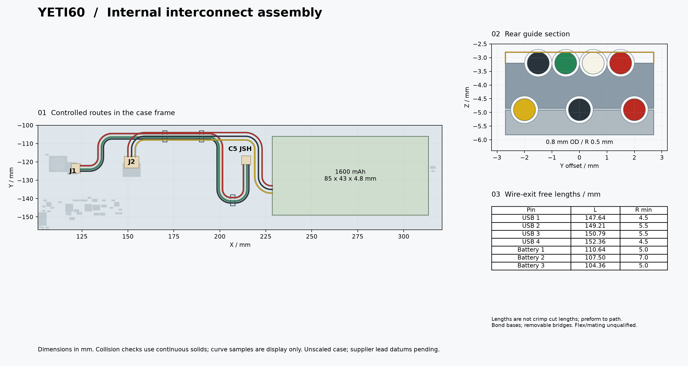

English | [Chinese](interconnects.zh-CN.md)

# Internal cables and removable routing guides

The internal connection remains **C5 JSH -> four-wire SH harness -> mainboard J1**, with the protected battery pack connected to J2 by its three-wire PH lead. No UDB S or second controller is used. [The complete specification](../../../../mechanical/interconnect-spec.json) and [checked geometry](../audit/yeti60-interconnects.json) govern this prototype; supplier exit datums and physical assembly remain unqualified.

[Vector drawing](images/interconnects.svg) · [Five placed guide parts, STEP/STL](../../../../mechanical/generated/interconnect-guides) · [Pack interface](battery-pack-specification.md)

## Connectors and conductors

| Interface | Parts per keyboard | Electrical contract |
|---|---|---|
| USB | One harness: two SHR-04V-S housings, eight SSH-003T-P0.2-H contacts, four AWG28 stranded wires | Pin 1 red VBUS; 2 white D-; 3 green D+; 4 black GND. Straight numbered pin-to-pin continuity; visual left/right order is not authoritative |
| Battery | Included in one pack: one PHR-3 housing, three SPH-004T-P0.5S contacts, three AWG28 stranded wires | Pin 1 red PACK+; 2 black PACK-; 3 yellow separate 10k NTC to PACK-. Independent protection is additional to the NTC |

Insulation OD must be <=0.8 mm and compatible with the specific contacts. [JST SH](https://www.jst.com/wp-content/uploads/2025/06/eSH.pdf) specifies a 5 x 5 x 2.8 mm SHR-04V-S housing; [JST PH](https://www.jst.com/wp-content/uploads/2025/06/ePH.pdf) gives 7.8 x 6.35 x 4.5 mm for PHR-3. Conservative complete mating envelopes are used in the CAD checks. They are dimensional proxies, not redistributed proprietary OEM models.

The inherited main J1 signal/mechanical lands match the standard SH footprint with a 0.0625 mm rigid origin translation; J2 matches the standard PH footprint with no translation. No header copper change is required. The C5 SH substitute model uses a corrected -1.45 mm Y offset, replacing the erroneous +2.425 mm offset; this changes the derived visualization, not the upstream daughterboard PCB.

## Controlled route

The USB route has a nominal 150 mm centerline; individual free lengths are approximately 147.64, 149.21, 150.79 and 152.36 mm for pins 1–4. These are insulation lengths between housing wire-exit planes, **not crimp cut lengths**. Use the unrounded seven-wire table in the report for manufacturing drawings. Each wire has its own length; a generic equal-length 150 mm ribbon is not automatically accepted.

The chosen wire rule is a minimum **4 mm static bend radius**, subject to the wire supplier's approval. The designed USB inner radii are at least 4.5 mm; battery inner radii at least 5 mm. Free-length tolerance is +/-0.5 mm, in addition to preforming and retention within the controlled path. The check inflates each wire by 0.25 mm radially for case/route position allowance and then requires at least 0.15 mm remaining air gap. Separate harnesses receive independent inflation. Seven continuous circular swept solids are used for collision checks; sparse samples are only used in the drawing.

Rear USB wires run at z=-3.20 mm and battery wires at z=-4.90 mm. The front USB loop runs at z=-4.90 mm to clear the H21 head at the ordinary board's maximum thickness. Connector lead transitions accommodate the 1.44–1.76 mm ordinary-board thickness range while the guide locations remain fixed; the report records both extremes and required free-length changes. The complete pack exits at local [0,14,4.4] mm toward -X, requiring supplier confirmation.

## Guide quantities and installation

| Item | Quantity | Geometry and placement |
|---|---:|---|
| Rear bases | 2 | One each `rear-1-base` and `rear-2-base`; case X=170/190, Y=-106 mm; width 5.4, route-direction length 2 mm; bottom conforms to the case |
| Rear bridges | 2 | One each `rear-1-bridge` and `rear-2-bridge`; three lower and four upper grooves, radius 0.5 mm |
| Front base | 1 | `front-base`; X=207 mm and Y from the report; width 6, route-direction length 1.8 mm |
| Bridge retention tape | One small supply for two bridges | Removable nonconductive double-sided tape, 0.05 mm total thickness, applied only at the side lands |
| Upper retention film/tape | Three pieces | Total film plus adhesive thickness <=0.10 mm; cover the upper wires and wrap down the sides; do not leave a floating strip |

Published STEP/STL parts retain **case coordinates**. They are individually named placed parts, not five pieces to stack at a common origin. Do not scale them. Use a dimensionally qualified, tough, nonconductive polymer with smooth grooves. Bond bases to the shell across the 0.10 mm designed base bond gap; use a resin-compatible adhesive. Lay terminated harnesses in the open grooves, retain lower wires with removable bridges, then apply the upper retention film. Do not thread connectors through closed holes or permanently epoxy the bridges.

The guide solids clear the checked case, PCB, parts and fasteners without pinching nominal wire solids. The base footprint was narrowed to avoid the rear wall; the shell needs **no additional cable-routing cut** in this design. Guide strength, adhesive performance, wire springback and printed dimensional scatter still require physical samples.

## Inspection and service

Inspect every crimp, numbered continuity, pack polarity and NTC before connecting. Photograph the installed route against the drawing. Confirm no springback/bundle twist outside the keep-out envelope, no pouch/tab load, no sharp edges and full shell closure without pressure. Validate insertion/extraction clearance with real plugs. Service by disconnecting power and the battery, removing retention films/bridges and lifting the complete harness; never pull a cell tab or pry against the pouch. Cable electrical SI/RF remains unqualified after initial screening, and no fatigue/pull-force certification is claimed.
