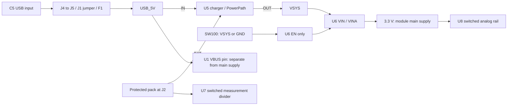

English | [Chinese](power-states.zh-CN.md)

# Power switch, reset and off-state current

**SW100 controls regulator enable; it does not disconnect the pack.** The charger, regulator input and battery-measurement switch input remain connected. With USB attached, the module's VBUS pin remains live even when its main 3.3 V supply is off. Disconnect USB, pack and any external power before soldering or changing wiring; verify stored rail voltage has decayed.

The current candidate netlist, component records and runtime USB-policy evidence pass the [power-state check](../audit/power-states.json). This is a connectivity/arithmetic review, not an electrical simulation or physical acceptance. No PCB, component quantity, firmware byte or calibration identifier changes in this review.



## Distinguish the states

Values are charger-pin levels. Permission does not guarantee current: valid input, battery, temperature, timer and protection conditions still apply.

| State | CE_N / EN1 / EN2 | Meaning |
|---|---|---|
| SW100 off; pins undriven | 0 / 0 / 0 | R42/R43/R44 pull down; valid USB can permit autonomous USB100 charging; no keyboard enumeration |
| MCU held in reset / before GPIO ownership | 0 / 0 / 0 | Same hardware default, even with SW100 on; the initialized-firmware inhibit is not yet active |
| GPIO initialization completed; USB unconfigured | 1 / 0 / 0 | Charging inhibited; USB100 input mode for system power |
| Accepted USB configuration | 0 / 1 / 0 | Charging permitted within USB500 shared input budget |
| USB suspend / latched runtime fault | 1 / 1 / 1 | Software requests charge disable/input high impedance; normal operation needs battery support |
| USB bus reset / deconfiguration, MCU still running | 1 / 0 / 0 | Revokes the USB500 permission; not the same event as MCU reset |

The actual [runtime callback tests](../testing/usb-event-policy.md) cover states after the GPIO owner initializes. They do not execute hardware reset defaults or measure startup duration. Firmware-only charge inhibition cannot be claimed through loss of MCU power. A low/cut-off pack or removed pack during host suspend can cause loss of volatile USB/configuration state, reboot or a return to hardware defaults. **That failure path is unqualified**, even if suspend/resume with a healthy pack works. Do not accept reboot/re-enumeration as successful suspended operation.

U7's input is on BAT_CELL, but R51's divider top is on its switched output. U8 switches the analog rail. Both use their QOD pins through 100-ohm resistors. These controlled paths are not a complete pack disconnect or a claim of reverse-current isolation. SW100 off also does not guarantee instantaneous zero volts on stored output capacitance.

## No-USB off-current reference

These are specific manufacturer table entries, with different test conditions. Their sum is **not a whole-board maximum, expected total or storage-life guarantee**.

| Powered device | Typical | Listed maximum | Conditions / primary source |
|---|---:|---:|---|
| BQ24074 BAT sleep term | 4.3 µA | 6.5 µA | Input not detected, OUT unloaded, TJ=85°C; [SLUS810N p12](https://www.ti.com/lit/gpn/bq24074) |
| TPS63031 shutdown term | 0.1 µA | 0.9 µA | EN=0, VIN=VINA=3.6 V; [SLVS696D p5](https://www.ti.com/lit/ds/symlink/tps63031.pdf) |
| TPS22919 U7 shutdown term | 0.002 µA | 0.8 µA | ON low, VOUT grounded; typical at 25°C, maximum over −40…125°C; [SLVSEN5B p5](https://www.ti.com/lit/ds/symlink/tps22919.pdf) |
| Arithmetic reference subtotal | **4.402 µA** | **8.2 µA** | Sums of the entries above only |

The BQ unloaded condition differs from a real board with shutdown loads. Pack voltage/temperature, component/PCB leakage and pack protection/thermal electronics must also be characterized. U8 is downstream of the disabled main rail and is not counted as a second continuously battery-powered U7. R48 is grounded by SW100 off; the R51/R52 divider is not simply a permanent 2-megohm load across the pack.

A series measurement at the pack's J2 output measures board current, **not protection-circuit consumption inside the pack**. Cell charge loss also includes internal pack consumption and self-discharge. Obtain those terms from the supplier and measure the board; the existing planning assumption is not a pack rating.

For an explicitly assumed constant **cell-side** current, `loss_mAh = current_uA × hours / 1000`:

| Assumed current, not a prediction | Per day | Per 30 days |
|---:|---:|---:|
| 20 µA | 0.48 mAh | 14.4 mAh |
| 50 µA | 1.2 mAh | 36 mAh |
| 100 µA | 2.4 mAh | 72 mAh |

No lifetime in years is derived from these rows. See the [source terms](power-state-sources.json) and [reproducible arithmetic](../audit/power-states.json).

## First-board captures

1. Use the source/sink simulator before a real cell. Capture 3.3 V, VSYS, CE_N, EN1/EN2, USB input and pack-side current during SW100 off/on, cold start and MCU reset. Separate the pull-down default from the initialized firmware state; do not measure only after startup completes.
2. Capture USB **bus** reset/deconfiguration separately while the MCU stays running. Confirm initialized firmware inhibits charging. Verify configured concurrent charging and wired input afterward.
3. During host suspend with simulator support, remove/decrease battery support without a real cell. Record rail collapse/reboot, charger defaults, host state and input current. This is fault characterization, not an accepted behavior or permission to bypass USB suspend requirements.
4. With USB/debugger/external sources removed and rails settled, measure board off-current over the qualified pack voltage/temperature range. Record meter burden, instrument range and settling; do not let the measurement arrangement alter the state being measured. Characterize actual off-rail backfeed separately when USB is present.
5. Keep supplier qualification and monitored charge/termination/temperature tests from [B3–B7](../../OPEN-BENCH.md). The pack's normal cutoff remains required; neither the main switch nor regulator undervoltage lockout substitutes for it.

Reproduce from the repository root:

```sh
python3 variants/raytac/scripts/check_yeti60_power_states.py
python3 variants/raytac/tests/audit/test_power_states.py
```

[Build entry](../../BUILD.md) · [Charge/runtime calculations](power-budget.md) · [Pack requirements](battery-pack-specification.md)
