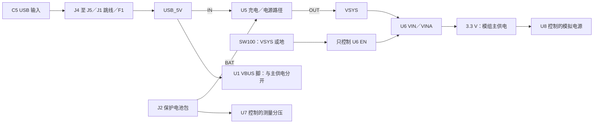

[English](power-states.md) | 简体中文

# 电源开关、复位与关机耗电

**SW100 控制稳压器使能，不是电池总断开。** 充电器、稳压器输入和电池测量开关的输入仍接在电源上。插着 USB 时，模组 VBUS 脚仍有电，即使主 3.3 V 供电已关闭。焊接或改线前断开 USB、电池和外部供电，并确认电源轨储能已经释放。

当前候选网表、元件记录及运行时 USB 策略证据通过了[电源状态检查](../audit/power-states.json)。这是连接和算术审查，不是电气仿真或实物验收。本轮不改变 PCB、元件数量、固件字节或校准标识。



## 区分各个状态

以下为充电控制脚电平。允许充电不代表一定存在充电电流，还受输入、电池、温度、计时及保护状态限制。

| 状态 | CE_N／EN1／EN2 | 含义 |
|---|---|---|
| SW100 关闭，三脚未被驱动 | 0／0／0 | R42／R43／R44 下拉；有效 USB 可以允许自主 USB100 充电，不能作为键盘枚举 |
| 主控保持复位／GPIO 尚未接管 | 0／0／0 | 即使 SW100 开着也回到相同硬件默认；此时尚无初始化后的固件禁充 |
| GPIO 初始化完成，USB 未配置 | 1／0／0 | 禁充；系统可使用 USB100 输入模式 |
| USB 配置已接受 | 0／1／0 | 在与系统共用的 USB500 输入预算内允许充电 |
| USB 挂起／运行时故障已锁定 | 1／1／1 | 软件请求禁充及输入高阻，正常运行需要电池支撑 |
| USB 总线复位／取消配置，主控仍在运行 | 1／0／0 | 撤销 USB500 授权；与主控复位不是同一件事 |

现有[实际运行时回调测试](../testing/usb-event-policy.zh-CN.md)覆盖 GPIO 持有者初始化后的状态，不执行硬件复位默认，也不测启动时长。主控断电后不能继续声称由固件保持禁充。主机仍挂起时，电池欠压保护切断、低电或拔除，都可能造成易失的 USB 配置／挂起状态丢失、重新启动或回到硬件默认。**这条失败路径尚未验收**；健康电池下挂起／恢复通过也不能替代它。不能把重启／重新枚举记为挂起成功。

U7 输入在 BAT_CELL 上，但 R51 分压上端接其受控输出；U8 控制模拟电源。两者的 QOD 脚均经 100 Ω 接输出。这些受控支路不等于电池总断开，也不代表已经实现反向电流隔离。SW100 关闭也不保证输出电容电压立即归零。

## 不接 USB 时的关机电流参考

以下来自原厂表格的特定条目，测试条件不同；相加结果**不是全板最大值、实际总电流预测或储存寿命保证**。

| 持续接电的器件 | 典型 | 表内最大 | 条件／原始资料 |
|---|---:|---:|---|
| BQ24074 BAT 休眠条目 | 4.3 µA | 6.5 µA | 未检出输入，OUT 无负载，TJ=85°C；[SLUS810N 第 12 页](https://www.ti.com/lit/gpn/bq24074) |
| TPS63031 关断条目 | 0.1 µA | 0.9 µA | EN=0，VIN=VINA=3.6 V；[SLVS696D 第 5 页](https://www.ti.com/lit/ds/symlink/tps63031.pdf) |
| TPS22919 U7 关断条目 | 0.002 µA | 0.8 µA | ON 低、VOUT 接地；典型为 25°C，最大为 −40…125°C；[SLVSEN5B 第 5 页](https://www.ti.com/lit/ds/symlink/tps22919.pdf) |
| 条目算术小计 | **4.402 µA** | **8.2 µA** | 仅为上面三个表项相加 |

BQ 无负载条件与真实板上仍存在关断支路的情况不同；电池电压／温度、元件及板面漏电、包内保护／温度电路还须另行表征。U8 位于已关闭的主电源下游，不再按第二个始终接电的 U7 相加。SW100 关闭将 R48 接地；R51／R52 也不是直接跨电池的永久 2 MΩ 负载。

在电池包 J2 输出线上串表测到的是主板电流，**不包含包内保护电路自己消耗的电流**。电芯电量损失还包括包内自耗和自放电；应取得供方数据并测量主板，现有规划假设不能当作电池包额定值。

若明确假设一个恒定的**电芯侧**电流，`损失 mAh = 电流 µA × 小时 / 1000`：

| 假设电流，不是预测值 | 每天 | 每 30 天 |
|---:|---:|---:|
| 20 µA | 0.48 mAh | 14.4 mAh |
| 50 µA | 1.2 mAh | 36 mAh |
| 100 µA | 2.4 mAh | 72 mAh |

不据此推导多年储存寿命。见[原始表项](power-state-sources.json)与[可重算结果](../audit/power-states.json)。

## 首板需要捕获什么

1. 先用可吸收充电电流的模拟器，不用真实电芯。捕获 SW100 开关、冷启动及主控复位时的 3.3 V、VSYS、CE_N、EN1／EN2、USB 输入及电池侧电流；区分硬件下拉默认与初始化后的状态，不能只在启动完成后读一次。
2. 主控保持运行，单独捕获 USB **总线**复位／取消配置，确认固件已经接管时禁充。之后检查接受配置后的边充边 USB 输入。
3. 主机挂起并由模拟器支撑时，在没有真实电芯的条件下撤除或降低电池支撑；记录掉电／重启、充电默认、主机状态和输入电流。这是故障表征，不是已接受的行为，也不能据此绕过 USB 挂起要求。
4. 断开 USB、调试器和外部来源，待轨电压稳定，在获准电压／温度范围测主板关机电流。记录表头负担电压、量程及稳定时间，不能由测量装置改变被测状态。USB 连接时的关闭电源轨反灌另测。
5. 保留 [B3～B7](../../OPEN-BENCH.zh-CN.md)要求的供方资格及受控充电／终止／温度验收。电池正常放电截止仍是必须项，主开关和稳压器欠压锁定不能代替它。

仓库根目录重现：

```sh
python3 variants/raytac/scripts/check_yeti60_power_states.py
python3 variants/raytac/tests/audit/test_power_states.py
```

[制作入口](../../BUILD.zh-CN.md) · [充电／续航计算](power-budget.zh-CN.md) · [电池包要求](battery-pack-specification.zh-CN.md)
