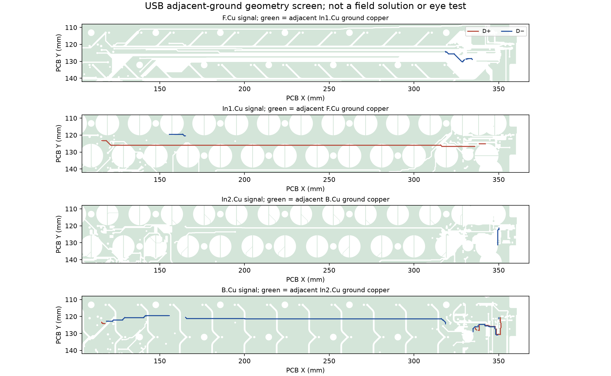

English | [Chinese](prototype-qualification.zh-CN.md)

# Pre-case Raytac qualification research

Scope: the sections below retain the canonical long-USB-route research. The [repair candidate](../../hardware/usb-short-route/README.md) and [nine-wire assembly package](../../hardware/usb-short-route/ASSEMBLY.md) now have separate native-electrical, installed-geometry and publication-consistency checks. The long-route numbers here do not describe that candidate; service/mating access, cable signal quality, supplier confirmation and physical acceptance remain open.

**Current conclusion: do not order the existing P2 PCB archive yet.** The [open-bench guide](../../OPEN-BENCH.md) includes a mandatory battery, but the USB routing and pack qualification still block readiness. This study records problems rather than declaring them repaired. No physical unit, USB eye, RF field solution, thermal simulation or cell test has been performed.

Reproduce with KiCad Python `scripts/export_yeti60_usb_reference.py`, then the CAD runtime `scripts/study_yeti60_prototype.py`. [JSON](../audit/prototype-research.json), [thermal CSV](../../hardware/bom/charging-thermal-scenarios.csv), and [primary-source registry](prototype-sources.json) contain inputs, formulas, assumptions and hashes.

## Dimensions and fastener interference

The current FELK60 exterior is 325.700×125.200×31.190 mm. The PCB outline envelope is 289.39×94.6 mm, ordinary nominal 1.6 mm, with an imposed incoming thickness range 1.44–1.76 mm. The 1.6 mm steel plate preserves all 60 sensing axes and has three plate-stabilizer combination cutouts. PCB holes remain 29, but **28 fastener sets are installed; H26 is entirely unused**. [Native assembly evidence](../audit/yeti60-assembly.json) reports zero nominal PCB/plate-to-case overlap and no checked component-envelope collisions. Supplier NiZ/stabilizer/keycap bodies and resin shrinkage are still unqualified.

The full XY screw budget is:

```text
radial margin = (PCB drill − drill diameter loss − screw maximum diameter)/2
                − nominal center offset − PCB position error
                − plate position error − adapter concentricity
```

Using the imposed tolerances in the assembly specification, the minimum is **0.061633 mm**. This is conditional on actual PCB/metalwork meeting those limits; it is not a measured manufacturing capability. Locate the PCB with screws loose before tightening evenly. Do not force a negative-clearance assembly or drill near EC copper as an improvised fix.

New proposed incoming axial limits: M1.6×5 under-head length 4.8–5.0 mm; PEEK washer 0.75–0.85 mm; insulating film 0.08–0.12 mm; adapter **usable full female thread depth >=3.1 mm**, not just drill depth. Then:

```text
minimum engagement = 4.8 − 0.85 − 1.76 − 0.12 = 2.07 mm
maximum engagement = 5.0 − 0.75 − 1.44 − 0.08 = 2.73 mm
minimum clearance to female-thread bottom = 3.1 − 2.73 = 0.37 mm
```

The top M2 stud still provides only 1.0/0.4=2.5 nominal thread turns. These geometric budgets do not qualify thread lead-ins, brass/steel strength, tightening torque or repeated assembly. Inspect a sample adapter/plate thread before ordering a batch. [NiZ/plate-stabilizer details](../build/key-mechanism.md) govern real clips, lower-skirt trimming and 6U full travel.

## USB: an actual layout risk, not a closed qualification item

Mainboard D+ and D− trace lengths are 253.541/249.122 mm. Their paths span different layers and 4/6 vias. New polygon analysis finds:

| Screen | D+ | D− |
|---|---:|---:|
| Length covered at its centerline by GND on the nearest adjacent copper layer | 66.00% | 79.29% |
| Length outside a 0.75 mm corridor around the other signal on the same layer | 241.22 mm | 236.36 mm |
| Furthest signal-via center from the nearest GND through-via center | 8.236 mm | 5.492 mm |

The 0.75 mm corridor is an engineering screen, **not an impedance rule**; proximity does not prove parallelism or coupling. Ground polygons preserve holes. Self-touching native polygons are normalized with individual area changes below 0.01 mm²; actual normalization deltas are recorded. Pad/via drill voids are not resolved by every native effective-shape API. The nearest adjacent layer is selected by physical stack distance, not assumed to be the actual RF return. Copper on other layers and coplanar ground can also carry return current. These figures expose a routing issue, not a prediction of packet error or an eye result.



[Nordic's engineer](https://devzone.nordicsemi.com/f/nordic-q-a/82014/nrf52840-usb-d-d--impedance-matching/340456) recommends matched routing and 90-ohm differential impedance for long tracks; the nRF already contains series termination. [Silicon Labs AN0046](https://www.silabs.com/documents/public/application-notes/an0046-efm32-usb-hardware-design-guidelines.pdf) supplies general USB layout guidance.

**Required repair:** rebuild the long section as a pair with one consistent reference, compact matched transitions and nearby return stitching, or bring a controlled data harness to a connector near U1. Retain populated C5 protection. Account for the C5/SH launches and actual cable; four arbitrary separated AWG28 wires do not establish 90 ohms. Preserve ordinary JLC through-via construction and EC copper/clearances. Re-run native DRC/connectivity, coupling/reference extraction, harness/assembly geometry, firmware fingerprints and output/render provenance after the chosen repair. No candidate route is released by this research.

## Charging heat and protocol

The primary [BQ24074 sheet](https://www.ti.com/lit/ds/symlink/bq24074.pdf) supports this explicitly conditional power model:

```text
P_IC ≈ (V_IN−V_BAT)×I_CHG + (V_IN−V_OUT)×I_SYS + V_IN×I_bias
T_j ≈ T_ambient + P_IC×theta_JA
```

At assumed input 5.25 V, cell 3.2 V, programmed current corner 445.633 mA, system input 40 mA, OUT 4.4 V and an illustrative 1.5 mA bias allowance, estimated dissipation is **0.95542 W**. TI's JEDEC reference-board 44.5 °C/W gives about **82.52 °C** junction at 40 °C ambient. A **90 °C/W sensitivity assumption** gives **125.99 °C**, entering the thermal-regulation region. Neither thermal resistance describes a measured YETI60 board. Foldback and current limiting will change actual current; this is not CFD, transient SPICE or cell-temperature prediction.

Use the fixed 5 V USB input contract. USB500 is an input limit shared with the system; it is not cell charge current and does not imply PD/QC support. Current/timer/CV calculations remain in [power budget](power-budget.md). The dynamic safety timer slows proportionally under the documented limiting conditions; do not infer a guaranteed off-state full-charge time from 1600/100 alone or reset the timer to evade a fault.

## Battery measurement and safety findings

The actual native nets identify **C47=10 nF between BAT_ADC and GND**. C48=1 µF is between AFE_3V3 and GND and is not the battery filter. The study selects shunt capacitance from connectivity and tests that renumbering parts cannot alter the result.

```text
R_Thevenin = R51 || R52 = 1 Mohm || 1 Mohm = 500 kOhm
tau = R_Thevenin × C47 = 5 ms
50 ms step-settling error = exp(−50/5) = 0.00454%
time to 0.1% settling ≈ 34.54 ms
```

**Nominal RC settling passes; do not change C48.** Assuming capacitor +10% and both divider resistors +1%, the RC-only residual after 50 ms is approximately 0.0123%. This does not include divider-ratio error, ADC reference/gain/offset/noise, leakage or sensor accuracy. Those require an error budget and actual measurements before choosing a software cutoff. Normal target battery reporting remains disabled and no autonomous low-voltage stop is implemented.

For the charger sensor, use the actual [SEMITEC 103AT nominal R/T table](https://www.semitec-global.com/uploads/2022/01/P12-13-AT-Thermistor.pdf), not an extended single-beta estimate. Log interpolation with BQ nominal thresholds gives a cold crossing near **−0.59 °C** and hot crossing near **51.22 °C**. Charger electrical corners alone extend this approximately to **−2.56…1.48 °C cold / 47.12…55.74 °C hot**, before NTC errors, self-heating and lag. Thus a plain feedback NTC cannot enforce the requested actual **15–43 °C** charging window.

The pack remains **mandatory**. Its separate hardware temperature interruption, voltage/current/short protection, corrected cell limits and signed complete drawing are still required. [MinebeaMitsumi MM3855](https://product.minebeamitsumi.com/en/product/category/ics/battery/protection/parts/MM3855Series.html) demonstrates temperature-capable protection circuitry exists; it is not a selected suffix, a purchasable finished pack, or proof of the required cold cutoff. [EEMB](https://www.eemb.com/information/16) distinguishes PCM functions from NTC sensing. Neither a generic “PCM” nor “three-wire NTC” listing closes this requirement.

The [cell sheet](https://www.honcell.com/Public/Uploads/uploadfile/files/20240401/DATASHEETHCP4040743.7V1600mAhCELL2024.pdf) states 3.0 V discharge cutoff. Normal firmware has no implemented low-voltage stop. Require explicit pack cutoff/recovery/tolerance/leakage acceptance; do not assume a common 2.4 V protector implements a 3.0 V operating cutoff. Initial supervised discharge stops at loaded 3.2 V. Confirm pack protection on a simulator, not by shorting, overheating or deeply discharging a real pouch.

The default package also needs a real sensor layout: the SEMITEC 103AT-2 drawing gives a body thickness up to 2.4 mm. Stacking that on the cell's 4.3 mm cycled thickness would reach 6.7 mm before wrap, exceeding the 4.8 mm complete-pack limit. Require a qualified thin compatible sensor or a properly coupled end-bay arrangement in the supplier section drawing; neither a generic thermistor label nor the current render proves fit.

## Protection coverage and residual risk

There is no defensible safety percentage or whole-keyboard certification at this stage. The main unresolved hazards and controls are:

| Hazard | Existing control | Missing evidence / action |
|---|---|---|
| Cell short / overcurrent | Required pack PCM; USB-side fuse only covers its input path | Verify actual PCM thresholds, MOSFETs and interrupt behavior; never prove a real pouch by shorting it |
| Hot/cold charging | BQ feedback plus required independent cell-coupled pack interruption | Plain NTC window is too broad for this cell contract; require qualified independent hot and cold limits, including sensor failure and thermal lag |
| Overcharge | BQ CC/CV plus required independent pack protection | Supplier must approve CV tolerance and protection thresholds, errors, recovery and delay |
| Deep discharge | Required pack operating cutoff; initial bench manual 3.2 V stop | No target software cutoff; verify the 3.0 V cell contract rather than trusting an unspecified generic PCM |
| Reversed pack / harness | Keyed housing with a custom pin assignment | No qualified mainboard reverse-battery protection is claimed; meter-check pin numbers and polarity before mating |
| Charger overheating | IC thermal regulation | Board-specific thermal resistance, soldered exposed pad, input/load corners and cell temperatures remain unmeasured |
| Mechanical damage | Insulating fixture/tray and controlled fasteners | Confirm full thread depth, no metal contact with pads, no pouch compression, abrasion or tab/lead tension |

The simulator/resistor fixture validates the **mainboard** charge path and feedback. It does not validate the purchased pack's PCM or its independent sensor attachment. Obtain the supplier's protection test records and separately qualify the pack/protector with an appropriate fixture before real-cell acceptance.

## Remaining work and release condition

| Item | Current state | Evidence needed to close |
|---|---|---|
| Steel stabilizer openings | Drawn and checked | Real K04/K05/K06 compatibility, NiZ skirt/clip retention, 6U both-end travel and local plate stiffness |
| PCB/plate/case fasteners | Conditional geometry passes | Incoming XY/drill limits, usable threads, no bottoming, physical sample; shell not needed for initial plate/PCB tests |
| Long USB route and harness | **Design repair required** | Controlled replacement routing, full regression, actual enumeration/traffic/eye with final cable |
| Battery ADC | Nominal C47 RC settling passes | ADC/divider accuracy, voltage measurements and conservative cutoff policy; reporting remains disabled |
| 1600 mAh pack | **Not procurement-approved** | Corrected manufacturer current limits, actual hot/cold interruption, voltage/current/cutoff and full package drawing |
| Charger/regulator/passives | Calculations only | Effective MLCC capacitance, fuse derating, exact MPNs, rails/transients, full-cycle and temperature measurements |
| BLE / 60-key EC | Host/geometry evidence only | Open-bench real pairing, both transports, calibration, neighboring-key noise, charge/typing coexistence |

The [open-bench procedure](../../OPEN-BENCH.md) is ready as a test plan. It does not claim that the current PCB or an unspecified battery has passed those tests.
