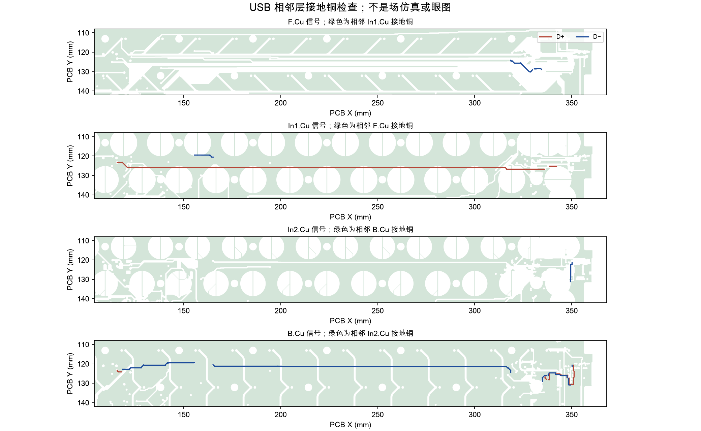

[English](prototype-qualification.md) | 简体中文

# 无外壳首样的 Raytac 验收研究

范围说明：下文保留原目录长 USB 线路的研究结论。[修补候选板](../../hardware/usb-short-route/README.zh-CN.md)及其[九线装配资料](../../hardware/usb-short-route/ASSEMBLY.zh-CN.md)已经另行完成原生电气、最终安装几何及图纸一致性检查。本文中的长线数值不代表候选板；检修插接路径、线束信号质量、供方确认及实物验收仍未完成。

**当前结论：暂不下单现有 P2 制板包。**[无外壳首样流程](../../OPEN-BENCH.zh-CN.md)保留必需的电池，但 USB 布线与电池资格仍阻塞放行。本次记录发现的问题，没有把它们标成已修复。目前没有实物、USB 眼图、射频场求解、热仿真或电芯测试。

复现方法：先用 KiCad Python 执行 `scripts/export_yeti60_usb_reference.py`，再用 CAD 环境执行 `scripts/study_yeti60_prototype.py`。[机器数据](../audit/prototype-research.json)、[温升情景表](../../hardware/bom/charging-thermal-scenarios.csv)和[原厂来源登记](prototype-sources.json)记录输入、公式、假设与哈希。

## 整体尺寸及紧固件干涉

当前 FELK60 外形为 325.700×125.200×31.190 mm；PCB 板框包围尺寸为 289.39×94.6 mm，普通工艺标称板厚 1.6 mm，约束收货范围 1.44—1.76 mm。1.6 mm 钢板保留 60 个感应轴心，并有三组钢板卫星轴组合开孔。PCB 原 29 孔保留，但**只安装 28 套五金，H26 整套留空**。[原生装配证据](../audit/yeti60-assembly.json)显示，名义 PCB／定位板与外壳无实体重叠，已检查的元件包络没有碰壳；供方 NiZ／卫星轴／键帽外形及树脂收缩尚未验收。

螺钉横向预算计算为：

```text
径向余量 =（PCB 孔径 − 孔径负公差 − 螺钉最大直径）÷2
          − 名义孔心偏差 − PCB 孔位置公差
          − 钢板孔位置公差 − 转接柱同轴度误差
```

按装配规格中约束的加工误差，最小值为 **0.061633 mm**。这是“实际加工满足这些条件时”的余量，不是板厂已实测达到的能力。先松装全部螺钉，确认 PCB 自然就位，再均匀锁紧；不能硬拉孔位，也不能临时在静电容铜面附近扩孔补救。

新增建议收货要求：M1.6×5 螺钉头下长度 4.8—5.0 mm；PEEK 垫片厚 0.75—0.85 mm；绝缘膜厚 0.08—0.12 mm；转接柱下方**完整可用内螺纹深度至少 3.1 mm**，不能把钻孔深度当作有效牙深。由此得到：

```text
最短啮合 = 4.8 − 0.85 − 1.76 − 0.12 = 2.07 mm
最长啮合 = 5.0 − 0.75 − 1.44 − 0.08 = 2.73 mm
距内螺纹底部最小剩余 = 3.1 − 2.73 = 0.37 mm
```

上端 M2 螺柱仍只有 1.0÷0.4＝2.5 圈名义啮合。这些几何计算不证明螺纹入口、铜柱／钢板强度、锁紧扭矩或重复拆装寿命；批量采购前应先拿一组铜柱／钢板牙孔试装。[NiZ／钢板卫星轴指南](../build/key-mechanism.zh-CN.md)继续约束真实卡扣、下裙边修整及 6U 完整行程。

## USB：查出了布局风险，尚未验收

主板 D+／D− 实际线段中心线长 253.541／249.122 mm，分别跨不同铜层并经过 4／6 个过孔。新的多边形检查结果为：

| 检查项 | D+ | D− |
|---|---:|---:|
| 线中心在最近相邻铜层被接地铜覆盖的长度比例 | 66.00% | 79.29% |
| 不在同层另一根信号线 0.75 mm 邻域内的长度 | 241.22 mm | 236.36 mm |
| 信号过孔距最近接地通孔的最大中心距离 | 8.236 mm | 5.492 mm |

0.75 mm 邻域只是工程筛查参数，**不是阻抗标准**；靠近也不能证明平行或正确耦合。接地多边形保留孔洞；原生自接触边界经过规范化，单个面积变化低于 0.01 mm²，实际变化值写入机器报告。部分原生有效铜形状接口不单独扣除焊盘／过孔钻孔。最近相邻铜层按叠层距离选择，不代表它一定承担真实高频回流；其他层和共面接地也可能参与回流。这些数据揭示布局问题，不是丢包率或眼图预测。



[Nordic 工程师的原厂答复](https://devzone.nordicsemi.com/f/nordic-q-a/82014/nrf52840-usb-d-d--impedance-matching/340456)建议长距离使用匹配线对及 90 Ω 差分阻抗；nRF 内部已有串联端接。[Silicon Labs AN0046](https://www.silabs.com/documents/public/application-notes/an0046-efm32-usb-hardware-design-guidelines.pdf)提供一般 USB 布局指导。

**必须修补：**长距离部分重新按成对、参考连续、紧凑匹配换层及邻近接地过孔设计；或在 U1 附近引入受控数据线束连接器。保留完整 C5 的保护。C5／SH 接头过渡和真实线缆也须计入，四根任意分开的 AWG28 线不能直接证明具有 90 Ω 阻抗。保持 JLC 普通机械通孔及静电容铜／间距要求；选定修补后重做原生 DRC／导通、耦合／参考检查、线束／装配、固件指纹和制板／图像来源验证。本次研究没有放行候选布线。

## 充电发热与协议

按 [BQ24074 原厂资料](https://www.ti.com/lit/ds/symlink/bq24074.pdf)建立明确带条件的模型：

```text
芯片功耗 ≈（输入电压 − 电池电压）×充电电流
          ＋（输入电压 − 系统输出电压）×系统输入电流
          ＋ 输入电压×芯片偏置电流
结温 ≈ 环境温度＋芯片功耗×结到环境热阻
```

取假设输入 5.25 V、电芯 3.2 V、充电编程电流最大角 445.633 mA、系统输入 40 mA、系统输出 4.4 V，以及作为工程余量的 1.5 mA 偏置电流，估算功耗 **0.95542 W**。采用 TI 测试板的 44.5 °C/W，在 40 °C 环境得到约 **82.52 °C** 结温；改用 **90 °C/W 敏感性假设**则为 **125.99 °C**，进入热调节区域。两个热阻都不是 YETI60 的实测值；限流和降流会改变真实电流。这不是流体热仿真、瞬态电路仿真或电芯温度预测。

输入保持固定 5 V USB 协议。USB500 是与系统共享的输入限额，不是电芯充电电流，也不代表支持 PD／QC。[功耗与充电计算](power-budget.zh-CN.md)保留电流、定时及稳压条件。原厂说明限流／热调节等条件下动态定时会按比例变慢，不能只用 1600÷100 保证关机充满时间，也不能反复复位定时器来规避故障。

## 电池测量及安全发现

原生网络表确认：**C47＝10 nF 接在 BAT_ADC 与地之间**；C48＝1 µF 接在 AFE_3V3 与地之间，是模拟电源去耦，不是电池滤波。研究脚本按真实连接选择滤波电容，并测试“交换器件编号也不能改变电气计算结果”。

```text
戴维南等效电阻 = R51∥R52 = 1 MΩ∥1 MΩ = 500 kΩ
时间常数 = 500 kΩ×C47（10 nF）= 5 ms
50 ms 后的阶跃稳定误差 = exp(−50÷5) = 0.00454%
达到 0.1% 稳定误差需约 34.54 ms
```

**名义 RC 稳定时间通过，不要改动 C48。** 假设电容为＋10%、两个分压电阻均为＋1%，50 ms 后仅 RC 部分的剩余误差约为 0.0123%。这不包含分压比、ADC 参考／增益／偏移／噪声、漏电及传感器误差；选择软件低压截止前仍需误差预算与真实电压测量。正式固件目前保持电池报告关闭，尚未实现自主低压停止。

温度计算采用 [SEMITEC 的 103AT 原始阻温表](https://www.semitec-global.com/uploads/2022/01/P12-13-AT-Thermistor.pdf)，不直接外推单一热敏常数公式。对 BQ 标称阈值作对数插值，得到冷端约 **−0.59 °C**、热端约 **51.22 °C**；仅考虑充电器电气角，约扩展至冷端 **−2.56…1.48 °C**、热端 **47.12…55.74 °C**，尚未加入 NTC 误差、自热及热延迟。因此，一颗普通反馈 NTC 不能保证本项目要求的实际 **15—43 °C** 充电窗口。

电池**仍是必需品**，但独立硬件温度断充、电压／电流／短路保护、电芯更正参数及完整包络签图仍不可省略。[MinebeaMitsumi MM3855](https://product.minebeamitsumi.com/en/product/category/ics/battery/protection/parts/MM3855Series.html)证明存在带温度检测的保护器件，不代表已选定后缀、能直接采购合格成品包，或已经证明冷端保护。[EEMB 的厂商说明](https://www.eemb.com/information/16)将保护板功能与 NTC 感温分别介绍；商品只写“带保护板”或“三线 NTC”，均不能关闭此项。

[电芯表](https://www.honcell.com/Public/Uploads/uploadfile/files/20240401/DATASHEETHCP4040743.7V1600mAhCELL2024.pdf)写明正常放电截止为 3.0 V。正式固件没有低电压停止功能，必须让供方明确保护包的截止／恢复／误差／延迟／漏电，不能默认常见 2.4 V 保护器就是 3.0 V 正常使用截止。初次有人监测的放电在带载 3.2 V 停止；保护故障在模拟器验证，不拿真实软包短路、过热或深放。

最终电池包还必须核对真实传感器位置：SEMITEC 的 103AT-2 图纸给出的本体厚度可达 2.4 mm，若叠在循环后最大 4.3 mm 的电芯大面上，未包覆就可能达到 6.7 mm，超过完整包 4.8 mm 限制。必须由供方剖面图证明薄型兼容传感器或端部有效耦合安排；通用热敏电阻名称和当前渲染均不能证明能装下。

## 保护覆盖及剩余风险

当前不能给出可靠的“安全百分比”，也没有整机安全认证。主要未关闭风险和控制如下：

| 风险 | 现有控制 | 尚缺证据／操作 |
|---|---|---|
| 电芯短路／过流 | 要求电池包自身保护；USB 侧保险丝只保护其输入路径 | 核实实际保护阈值、开关管及中断行为；不能短路真实软包来证明保护有效 |
| 过热／过冷充电 | BQ 反馈及要求的独立贴近电芯温度断充 | 普通 NTC 温区宽于本电芯合同要求；独立冷／热阈值还须计入传感器故障和热延迟 |
| 过充 | BQ 恒流／恒压和要求的独立电池保护 | 供方确认稳压范围、保护阈值、误差、恢复及延迟 |
| 深度放电 | 要求电池正常截止，首次台架带载 3.2 V 手动停止 | 正式固件无软件低压停止；核对 3.0 V 电芯要求，不能相信未说明阈值的通用保护板 |
| 电池／线束反接 | 有防反插壳，但针序为自定义 | 没有宣称主板已通过反接保护验收；连接前按针号用表确认极性 |
| 充电芯片过热 | 芯片内部热调节 | 本板热阻、底部散热焊盘、输入／负载角及电芯温度均未实测 |
| 机械损伤 | 绝缘夹具／托盘及受控紧固件 | 实测完整牙深，无金属碰焊盘，无软包受压、磨损及极耳／引线拉力 |

模拟器／替代电阻夹具验证的是**主板**充电路径和反馈，不代表买到的电池保护板或独立传感器贴合已获验证。真实电池验收前，须取得供方保护测试记录，并用适合的夹具单独验收电池包／保护器。

## 未关闭项目与放行条件

| 项目 | 当前状态 | 关闭所需证据 |
|---|---|---|
| 钢板卫星轴开孔 | 已绘制并检查 | K04／K05／K06 实物匹配、NiZ 下裙边／卡扣、6U 两端全行程及局部钢板刚度 |
| PCB／钢板／外壳紧固件 | 有条件的几何检查通过 | 收货孔位／孔径、有效螺纹、无顶底及实物样件；首轮 PCB／钢板试装无需外壳 |
| 长 USB 线路与线束 | **需设计修补** | 受控替换线路、完整回归及最终线缆下真实枚举／数据／眼图 |
| 电池 ADC | C47 名义 RC 稳定时间通过 | ADC／分压精度、电压实测及保守低压策略；电池报告保持关闭 |
| 1600 mAh 保护包 | **未放行采购** | 电芯更正电流参数、真实热／冷断充、电压／电流／截止和完整包络签图 |
| 充电／稳压／阻容 | 仅计算 | 有效电容、保险丝降额、准确型号、电源／瞬态、完整周期和温度实测 |
| 蓝牙／60 键静电容 | 仅主机／几何证据 | 无壳真实配对、双链路、校准、邻键噪声及边充边输入 |

[无外壳流程](../../OPEN-BENCH.zh-CN.md)已经形成可执行的测试计划，不代表当前 PCB 或未选定的电池已通过这些测试。
