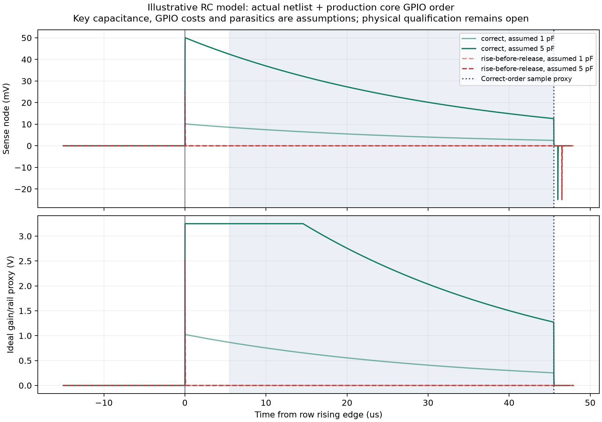

English | [Chinese](analog-waveform.zh-CN.md)

# EC charge/discharge order and analog timing study

Applies to the current Raytac [first-article board and matched firmware](../../hardware/usb-short-route/FIRST-ARTICLE.md). The production core now **releases the discharge clamp before the row rises, then reclamps before the row falls**. Both normal and calibrator builds contain the correction. No PCB, component value or JLC process changes are required. Recalibrate after upgrading: the changed core/scanner invalidate older v3 thresholds.

## Electrical review and regression

The earlier core raised a row while the shared sense node was still clamped to ground. Releasing the clamp afterwards cannot recreate charge already removed from C10. Its cleanup also lowered the row before reclamping, allowing the falling edge to couple into the floating sense node. The [pinned original EC60 firmware](https://github.com/4pplet/EC60/blob/b9c04625bb9944f6fb806aa571da8592cdff8565/Firmware/ec60/ec_switch_matrix.c) already releases before driving its row and discharges after reading; the Raytac port had reversed these relationships.

The corrected sequence for each of the 75 scanned matrix positions is:

1. Select the mux with both banks inhibited; enable only the selected bank. Keep all rows low and clamp the shared sense node during the 10 µs discharge wait.
2. Release the clamp, then drive one row high. Wait 5 µs before requesting ADC sampling.
3. Read the ADC. The target currently configures a 40 µs acquisition interval, plus unqualified channel-setup/start, conversion and scheduling delays.
4. Clamp the node again **before** lowering the row. On a bad ADC result, release key states and latch the AFE off as before.

The host GPIO test checks both edge relationships for every scan; two deliberately reversed production-core variants must fail. The transient study obtains its PWL control signals by compiling and tracing the actual core, rather than hand-drawing a desired sequence.

## Model boundary and calculations

The script reads both actual netlists and requires the analog topology/values to agree: R6=100 Ω, the selected column bleeder R8=100 kΩ, C10=220 pF, OPA350 non-inverting input on the shared node, R16=100 kΩ feedback and R17=1 kΩ to ground. JP1 remains open. Nominal closed-loop gain is `1 + 100000/1000 = 101`.

It models the selected column's passive RC circuit in ngspice. [Explicit assumptions](analog-waveform-inputs.json) include 1 pF released / 5 pF pressed example keys; four other grounded-row keys at 1 pF each; 80 pF bus and 20 pF column parasitics; 200 Ω mux resistance; 40 Ω clamp and extra row-driver resistance; 0.5 µs per GPIO call and 10 ns edges. These are **illustrative assumptions, not measured NiZ capacitances, extracted parasitics, worst-case component ratings or nRF execution times**. The two mux common pins alone have a typical 25 pF each in the Nexperia table; the 80 pF aggregate is an engineering allowance, not a guaranteed bound.

A useful approximate check after the fast edge is:

```text
C_total ≈ C10 + C_bus + C_column + 4*C_other_key + C_selected_key
V_sense(0+) ≈ V_row * C_selected_key / C_total
V_sense(t) ≈ V_sense(0+) * exp(-t / (R_column*C_total))
V_proxy = clip(101*V_sense, 0, 3.25 V)
ADC_proxy = clip(round(V_proxy / 3.6 V * 4096), 0, 4095)
```

For the example 1 pF key, `C_total≈325 pF` and `R_column*C_total≈32.5 µs`. The simulator also includes the row/mux resistors, so this equation is a cross-check, not an exact replacement for the transient solution. The output is an **ideal gain/rail proxy**, not a TI OPA350 dynamic macromodel or a simulated SAADC sample-and-hold. It omits real offset/noise, mux charge injection, leakage variation, amplifier recovery/stability, supply modulation, ADC loading and full-keyboard coupling. The nominal 3.6 V ADC range does not permit an input above the actual MCU VDD.



The [machine evidence](../audit/analog-waveform.json) contains the exact current results. With these assumptions and no additional API latency, the example samples occur 45.5 µs after the row command; corrected 1/5 pF cases have a useful proxy-code difference, while the reversed rising-edge cases lose that difference. Reversing only cleanup leaves the prior sample unchanged but increases the post-fall negative excursion. The numerical example does not establish a real key margin.

[Thirty-six capacitance/latency cases](analog-waveform-sensitivity.csv) sweep assumed key capacitance 0.5–20 pF and additional ADC API delay 0–200 µs. A delayed reading can approach baseline because the 100 kΩ path discharges C10. **A 40 µs acquisition setting is not an assurance that the physical sample occurs exactly 45 µs after excitation.** Nordic specifies acquisition time by source impedance; the EC signal is buffered, whereas the battery divider is a separate high-impedance path. Acquisition and excitation timing must be qualified together before changing either setting.

Source review of the [pinned Zephyr nRF SAADC driver](https://github.com/zmkfirmware/zephyr/blob/10ba6d0cb38bc3d258775d27982f707599320085/drivers/adc/adc_nrfx_saadc.c) confirms that single-ended negative offset codes are clamped to zero before `adc_read` returns. The adapter does not need a duplicate correction. This does not authorize below-ground input or qualify offset/temperature performance.

The ideal proxy can also clip near its assumed AFE supply while the ADC code remains below 4090. The calibration code's digital full-scale guard therefore does **not** prove that the real OPA350 is linear or unsaturated. Inspect the actual output waveform and rail along with population separation; saturated/overlapping or unstable key populations cannot establish acceptable sensing.

## First-board timing diagnostic and measurements

On the current USB calibrator shell, run:

```text
yeti_calibrate timing
```

No key needs to be held for this command. It prints successful sample count, cumulative minimum/maximum elapsed estimates since boot, and `clock_hz`. The actual resolved builds use a **32768 Hz RTC counter: one tick is about 30.52 µs**, not a high-resolution CPU counter. Measurement starts before the row GPIO driver call and ends after `adc_read` returns. Conversion adds one tick to cover quantization before rounding upward to nominal microseconds. These are **coarse RTC estimates**, not hardware sample timestamps, acquisition-duration measurements or a guarantee of absolute timing; oscillator accuracy is also unqualified. They include GPIO/ADC/interrupt overhead and exclude frame gaps/console-print pauses. Do not compare the displayed value directly against a fine-grained model time as a pass threshold. The command does not reset statistics or make per-mode histograms.

Capture real row, C10/shared-node and U3/ADC-output waveforms, and AFE supply. Record probe loading and include it in the model; probing the high-impedance node changes its capacitance. Check release-before-rise, clamp-before-fall, discharge completion, actual sampling window and output clipping. Collect release/press distributions on all 60 keys in active/idle AFE-gated modes and under battery BLE, USB typing and USB charging. Compare coarse timing estimates before/after load changes, but use hardware capture to identify the physical sampling instant. A long observed delay or overlapping population calls for timing/ADC-path repair and a new calibration; this study grants no arbitrary acceptable maximum delay.

## Reproduce and sources

With ngspice, host Clang and the pinned CAD Python dependencies installed, run from the variant directory:

```sh
python3 scripts/simulate_yeti60_firmware.py
python3 scripts/study_yeti60_analog_waveform.py
```

The second command needs NumPy/Matplotlib from `requirements-audit.txt` (NumPy is a dependency of Matplotlib) and the `ngspice` executable on PATH. This run records ngspice 47; its version is included in the evidence. It uses temporary circuits, compiles actual C under ASan/UBSan, rejects both order mutations, regenerates the plots/CSV and records source/output hashes. The full audit includes this stage; use `--refresh-guide` after scanner provenance changes.

Primary sources: [Nordic nRF52840 SAADC](https://docs.nordicsemi.com/r/bundle/ps_nrf52840/page/saadc.html) for acquisition/source-impedance and range; [TI OPA350 datasheet](https://www.ti.com/lit/ds/symlink/opa350.pdf) for amplifier limits; [Nexperia 74HC4051 datasheet](https://assets.nexperia.com/documents/data-sheet/74HC_HCT4051.pdf) for mux characteristics; [ngspice documentation](https://ngspice.sourceforge.io/docs.html) for the simulator. Datasheet typical values and these model results do not replace first-board validation.
