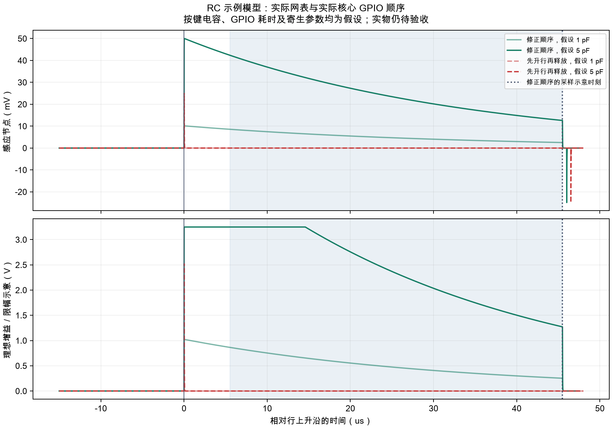

[English](analog-waveform.md) | 简体中文

# 静电容充放电顺序与模拟时序研究

适用于当前 Raytac [首板及配套固件](../../hardware/usb-short-route/FIRST-ARTICLE.zh-CN.md)。实际扫描核心已改为：**先释放放电钳位，再拉高行线；采样后先重新钳位，再拉低行线**。普通版和校准版均包含此修正，无需修改 PCB、元件数值或 JLC 工艺。升级后重新校准：核心／扫描源码变化会使旧 v3 阈值失效。

## 电气复核及回归

旧核心在共享感应节点仍被钳位到地时拉高行线，随后释放钳位不能恢复已经从 C10 泄掉的电荷。清理时还先拉低行线再钳位，使下降沿耦合到浮空感应节点。[固定版本 EC60 原始固件](https://github.com/4pplet/EC60/blob/b9c04625bb9944f6fb806aa571da8592cdff8565/Firmware/ec60/ec_switch_matrix.c)本来就先释放再驱动行线、读取后放电；Raytac 移植时把这两处关系反了。

现在 75 个矩阵扫描位置逐个执行：

1. 两组复用器均禁止时选通道，再只启用目标组。所有行保持低电平，感应节点钳位并等待 10 µs 放电。
2. 先释放钳位，再将一根行线拉高，等待 5 µs 后请求 ADC。
3. 读取 ADC。目标当前设置采集时间 40 µs，另有尚未实测的通道配置／启动、转换及调度延迟。
4. **先钳位感应节点，再拉低行线。** ADC 返回错误时，仍按原策略松开按键状态并锁定模拟前端断电。

主机 GPIO 测试对每次扫描检查这两处边沿关系；故意反转实际核心上升沿或下降沿顺序的两个变体均须失败。瞬态研究通过编译、跟踪实际核心来产生分段线性控制信号，没有手工画一条理想顺序充当固件执行结果。

## 模型边界及计算

脚本读取两份真实网表，要求模拟拓扑及数值一致：R6=100 Ω，所选列的泄放 R8=100 kΩ，C10=220 pF，OPA350 同相输入接共享节点，R16=100 kΩ 反馈、R17=1 kΩ 接地。JP1 保持开路。名义闭环增益为 `1＋100000/1000＝101`。

在 ngspice 中建立所选列的无源 RC 模型。[显式假设](analog-waveform-inputs.json)包括：示例松键／按键电容为 1／5 pF；另四个接地行的按键各 1 pF；总线寄生 80 pF、列寄生 20 pF；复用器导通电阻 200 Ω；钳位与额外行驱动电阻各 40 Ω；每次 GPIO 调用 0.5 µs；边沿 10 ns。它们是**示例假设，不是真实 NiZ 电容、提取寄生、器件最坏额定值或 nRF 实际执行耗时**。Nexperia 表中每个复用器公共端典型电容为 25 pF，两颗合计已有 50 pF；总量 80 pF 是工程预留，并非保证上限。

快边沿之后可作近似交叉核算：

```text
总电容 ≈ C10＋总线寄生＋列寄生＋4×其他按键电容＋当前按键电容
感应初始电压 ≈ 行电压×当前按键电容／总电容
感应电压(t) ≈ 感应初始电压×exp(−t／(列泄放电阻×总电容))
理想输出示意 ＝ 将 101×感应电压限幅至 0～3.25 V
ADC 数值示意 ＝ 将 round(理想输出示意／3.6 V×4096)限幅至 0～4095
```

示例 1 pF 按键得到总电容约 325 pF、时间常数约 32.5 µs。仿真还包含行串联／复用器电阻，因此上式只是交叉核算，不精确替代瞬态求解。输出为**理想增益／限幅示意**，不是 TI OPA350 动态宏模型，也未模拟 SAADC 的采样保持网络。模型未覆盖实际偏置／噪声、复用器电荷注入、漏电变化、运放恢复／稳定性、电源调制、ADC 负载及全键盘耦合。3.6 V 名义 ADC 量程也不允许输入超过主控实际 VDD。



[机器证据](../audit/analog-waveform.json)记录本次准确数值。在这些假设、没有额外 API 延迟时，示例采样在行命令后 45.5 µs：正确顺序保留了 1／5 pF 示例的数值差，错误上升沿顺序丢失该差值。仅反转清理顺序不会倒改已经完成的采样，但会增加下降沿后的负向扰动。示例数值不能证明真实按键裕量。

[36 组电容／延迟敏感性表](analog-waveform-sensitivity.csv)扫描假设电容 0.5～20 pF、额外 ADC API 延迟 0～200 µs。因为 100 kΩ 路径持续泄放 C10，读得过晚可能接近基线。**设置采集 40 µs，不等于实际采样恰好发生在激励后 45 µs。** Nordic 按源阻抗规定采集时间；静电容通路经过运放缓冲，电池分压则是另外一条高阻通路。修改任一参数前，必须一起确认激励、信号稳定和采集时序。

源码复核确认：[固定版本 Zephyr nRF SAADC 驱动](https://github.com/zmkfirmware/zephyr/blob/10ba6d0cb38bc3d258775d27982f707599320085/drivers/adc/adc_nrfx_saadc.c)会在 `adc_read` 返回前把单端负偏移数值归零，适配层不必重复转换。这不代表允许低于地的输入，也不证明偏移／温漂性能合格。

理想输出示意在接近假设模拟供电时可能限幅，但 ADC 数值仍低于 4090。因此校准代码的数字满量程保护**不能证明真实 OPA350 线性或没有饱和**。必须同时查看实际输出波形、电源轨和松／按分布；饱和重叠或不稳定分布不能证明感应可用。

## 首板时序诊断及测量

使用当前 USB 校准版串口执行：

```text
yeti_calibrate timing
```

此命令不需要持按按键。输出启动以来成功采样数、累计最短／最长耗时估计，以及 `clock_hz`。实际解析构建使用 **32768 Hz RTC，一格约 30.52 µs**，不是高精度 CPU 计数器。从调用行 GPIO 驱动之前计时，到 `adc_read` 返回后结束；换算前增加一格量化余量，再按标称微秒向上取整。这些是**RTC 粗略估计**，不是硬件采样时间戳、实际采集时长或绝对时间保证，振荡器准确度也未实测。它们包含 GPIO／ADC／中断开销，不含帧间等待和控制台打印停顿；不能直接拿显示值与精细模型时刻比较来判定合格。命令不清零统计，也不区分工作模式直方图。

实测行线、C10／共享节点、U3／ADC 输出及模拟电源。记录探头负载并计入模型：探测高阻节点会改变其电容。检查释放先于上升沿、钳位先于下降沿、放电完成、实际采样窗口及输出限幅。在正常／空闲门控、仅电池蓝牙、USB 输入、USB 充电时，对全部 60 键采集松／按分布。对照负载切换前后的粗略耗时估计，但用硬件捕获确定实际采样时刻。若延迟异常或分布重叠，须修补时序／ADC 通路并重新校准；本研究没有凭空指定一个合格的最大延迟。

## 复现与依据

安装 ngspice、本机 Clang 及固定 CAD Python 依赖后，在方案目录执行：

```sh
python3 scripts/simulate_yeti60_firmware.py
python3 scripts/study_yeti60_analog_waveform.py
```

第二条需要 `requirements-audit.txt` 中的 NumPy／Matplotlib 环境（NumPy 为 Matplotlib 依赖），以及 PATH 中的 `ngspice`。本次使用 ngspice 47，版本写入证据。脚本在临时目录生成电路，以 ASan/UBSan 编译真实 C 源码、拒绝两种顺序错误、重绘图表及 CSV，并记录来源／产物哈希。总审查已加入该阶段；扫描来源变化后使用 `--refresh-guide`。

原始依据：[Nordic nRF52840 SAADC](https://docs.nordicsemi.com/r/bundle/ps_nrf52840/page/saadc.html)规定采集时间／源阻抗及量程；[TI OPA350 数据表](https://www.ti.com/lit/ds/symlink/opa350.pdf)规定运放条件；[Nexperia 74HC4051 数据表](https://assets.nexperia.com/documents/data-sheet/74HC_HCT4051.pdf)规定复用器特性；[ngspice 文档](https://ngspice.sourceforge.io/docs.html)说明仿真工具。典型参数及本模型结果不能代替首板验证。
