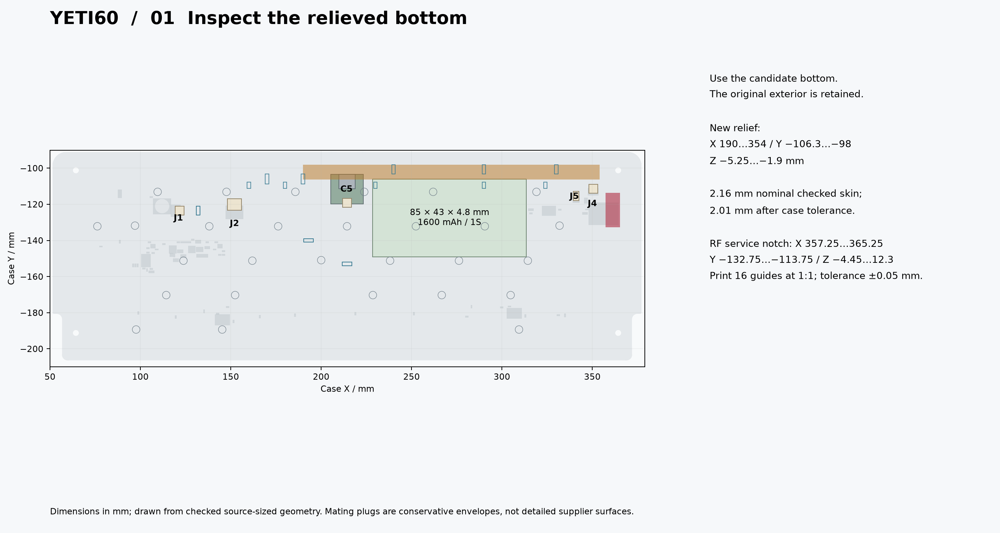
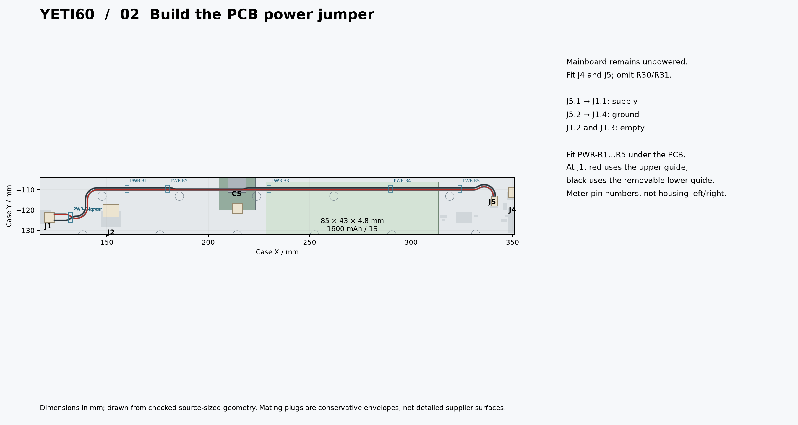
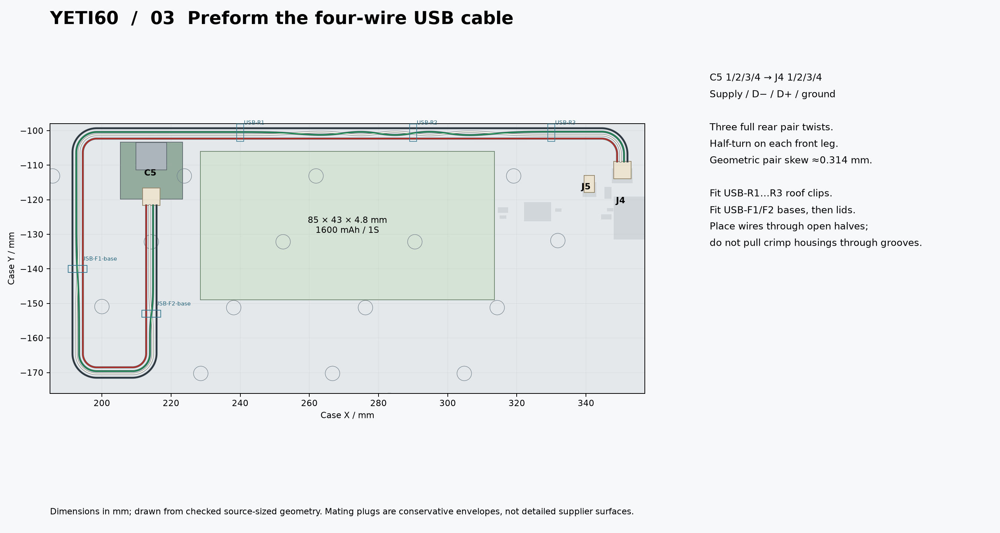
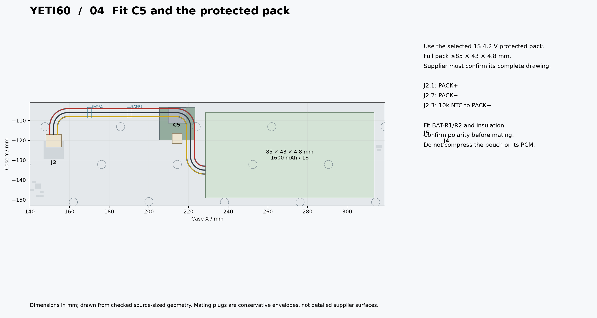
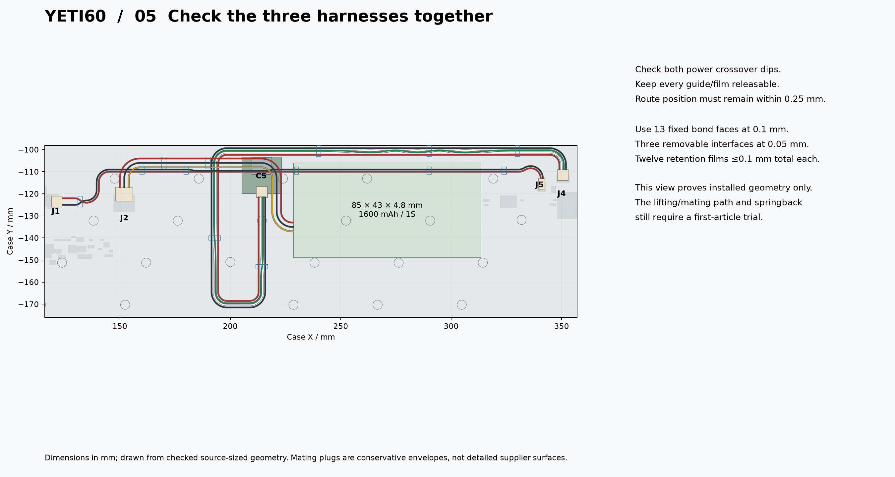
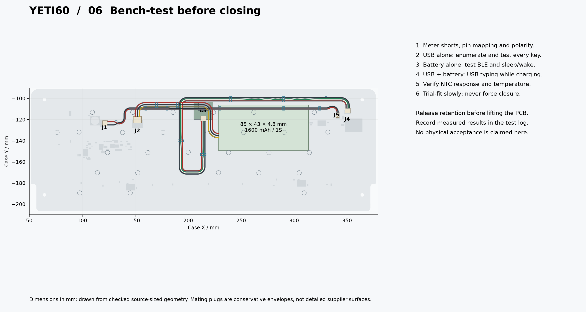
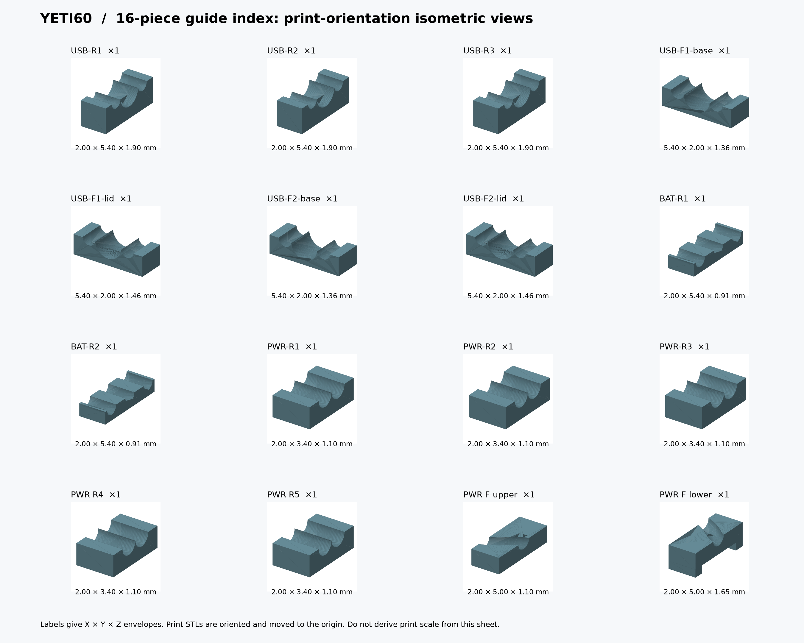
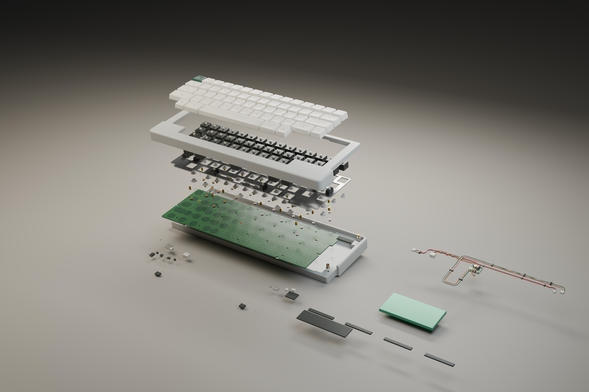

English | [Chinese](ASSEMBLY.zh-CN.md)

# Raytac repair candidate: enclosed assembly

**Service-path progress:** [the internal wing relief and rear clips are revised; continuous nominal rigid extraction passes with leads disconnected](SERVICE-PATH.md). Plug mating/unmating, wire deformation, loose-plug parking and combined tolerances remain unqualified; complete service is not approved.

Use this guide with the [candidate PCB, purchase table and firmware](README.md). It replaces the previous seven-wire enclosure illustrations. The old board archive, old five-piece guides and old cable lengths must not be combined with this assembly. Start electrical work with the candidate's [soldering and open-bench sequence](README.md#solder-and-open-bench-sequence).

The installed geometry is checked, including the five mating plugs. The lifting/mating service path, cable springback, adhesive retention and actual supplier parts still require a first article. This is an assembly design and trial-fit procedure, not a completed physical acceptance record.

Use the [revised passive specifications and seven 0805 power-capacitor positions](PASSIVES.md); old 0603 power-capacitor placement images are superseded for those positions.

## Prepare the changed materials

| Item | Specification | Per keyboard |
|---|---|---:|
| Mainboard | Candidate four-layer ordinary FR4, nominal 1.6 mm; use its native PCB and 75-part purchase table | 1 |
| F1 mainboard fuse | [Littelfuse 0466001.NRHF](F1-SELECTION.md), 1 A / 63 V one-time fast-acting; revised lands; no stock credit | 1 |
| J4 / J5 | JST SM04B-SRSS-TB(LF)(SN) / SM02B-SRSS-TB(LF)(SN), bottom side | 1 each |
| SH wire housings | SHR-04V-S for C5, J4 and J1; SHR-02V-S for J5 | 3 + 1 |
| SH contacts | SSH-003T-P0.2-H; J1 positions 2/3 stay empty | 12 fitted; buy 20 for spares |
| Battery housing / contacts | PHR-3 / SPH-004T-P0.5S, preferably supplied already crimped by the qualified pack vendor | 1 / 3 |
| Internal wires | AWG28 stranded copper, insulation OD 0.5–0.8 mm for a common SH/PH-compatible wire; nine controlled conductors | 9 |
| Bottom shell | [Relieved candidate STEP](mechanical/yeti60-bottom-short-usb.step) / [print STL](mechanical/yeti60-bottom-short-usb.stl), original exterior at 1:1 | 1 |
| Routing parts | [Sixteen distinct STL/STEP files](CLOSED-CASE.md#printed-parts); post-cured tough resin, dimensionally qualified ±0.05 mm | 16 |
| Fixed bond tape | Electrically insulating; assembled thickness 0.1 mm, without extra tape stacks | 13 bond faces |
| Removable bond tape | Electrically insulating; assembled thickness 0.05 mm | 3 interfaces |
| Retention film | Electrically insulating and removable, total thickness ≤0.1 mm including adhesive | 12 strips |
| Protected pack | Selected 1S 4.2 V design, minimum 1600 mAh, complete growth-inclusive envelope ≤85 × 43 × 4.8 mm; independent thermal charge interruption plus third-wire NTC | 1, supplier confirmation required |

All unchanged NiZ/plate-mounted stabilizer, plate, standoff, gasket, fastener, C5 and programming supplies are in the [main build handbook](../../BUILD.md). Keep its 28 mounting sets and leave H26 unused. This candidate changes the USB/power harnesses and bottom relief; it retains the previously checked plate/PCB stack. Do not buy a second battery lead set if the pack vendor supplies the specified complete harness.

## 01 — Inspect the case and prints

Use the candidate bottom, not the unmodified original bottom. Check the rear relief and all original insert bores. The checked skin adjacent to the new relief is 2.16 mm nominal, or 2.01 mm after the existing case tolerance; this is not a claim about every original shell wall. Print each guide once. STLs are already oriented at the print origin in mm; STEPs retain assembly coordinates. Deburr the channels without enlarging them arbitrarily.

## 02 — Solder and verify the power jumper

Follow the established staged soldering procedure for unchanged components, **omit R30/R31**, and fit J4/J5 at the candidate's native coordinates. Keep USB and battery disconnected during resistance and continuity checks. Install the PCB-side power guides and jumper **J5.1 → J1.1 / J5.2 → J1.4**. Confirm that J1.2/3 remain empty. At the J1 fan-out, red uses the upper path and black the removable lower path; place red before the lower guide.

## 03 — Preform the USB harness

Use [the nine public wire STEP files](mechanical/harness/) and the [free-length table](CLOSED-CASE.md#complete-wiring). Lengths are wire-exit to wire-exit; the harness supplier must calculate crimp cut lengths. USB D−/D+ have three full rear twists and a half-turn on each front leg, restoring the C5 pin order. C5 output 1/2/3/4 goes to J4.1/2/3/4. The roof clips and front split guides open for installing completed conductors; do not drag housings through the grooves.

## 04 — Fit C5, insulation and the protected pack

Complete the separate C5/mainboard power tests before inserting a real pack. Obtain the [supplier confirmations](../../docs/build/battery-vendor-checklist.md), including the full pack drawing, continuous charge rating, CV range and independent thermal charge interruption. Verify J2.1 = PACK+, J2.2 = PACK−, J2.3 = NTC to PACK− with a meter. Fit BAT-R1/R2 and insulation; keep the pouch, protection board, solder points and screw heads apart. Do not force a thicker pack into the CAD envelope.

## 05 — Trial-fit all three harnesses

Use the specified bond/film thicknesses and keep covers removable. Check both power crossover dips, the two-level J1 fan-out and the rear USB pocket. The final wire-position deviation must be within 0.25 mm of the controlled route; the allowance is a measured assembly requirement, not a guarantee that arbitrary print, tape and forming errors add up safely. Attach retention only after inspecting the complete route.

Arrange the harnesses while the stack is accessible and trial-lower it gradually. Stop if a plug cannot be reached, a wire springs out of its channel or seating requires force. **Static clearance does not prove that this insertion sequence can be executed.** Document the first-article mating/lifting motion; release all harness retention before lifting the PCB for service. No qualified swept service path or measured connector/adhesive force is available yet.

## 06 — Validate on the open bench, then trial-close

Complete the [B0–B7 electrical procedure](../../OPEN-BENCH.md), applying the candidate's J4/J5 map in place of the former J1 data connection. Required operating checks include USB alone, battery/BLE alone, USB input while charging, detach/reconnect, sleep/wake, all 60 calibrated keys and temperature. A case is unnecessary for the first functional test; the real NiZ/plate/dome/spring stack and the required protected pack are still necessary. Repeat the electrical and mechanical checks after a gentle trial closure; do not use a charging LED as evidence of correct USB data or safe cell temperature.

## Part index and full views

[Assembled keyboard](assembly/assembled.png) · [Rear view](assembly/rear.png) · [Installed cable and battery layout](assembly/battery-space.png)

The interior view hides the PCB/plate for route visibility; PCB-side guides remain at their actual installed datums.

The case, plate, PCB substrate, conductor paths, guides and C5 derive from checked original-size geometry. J1/J4/J5 use aligned native SH STEP models. J2 retains its conservative SMT PH body envelope because the installed library lacks its STEP model; a through-hole PH model is not substituted. Mating plug boxes, NiZ housings/sliders, domes/springs, keycaps, finish, component bodies and hardware details remain illustrative where supplier geometry is unqualified. Exploded separations are for visibility, not assembly travel distances. The PCB surface visual maps use native copper/pad geometry; they are not fabrication layers or an approved finish specification.

[Closed-case dimensions](CLOSED-CASE.md) · [Combined geometry evidence](audit/assembly.json) · [Drawing provenance](audit/assembly-drawings.json) · [Render provenance](assembly/render-manifest.json) · [Package consistency check](audit/assembly-package.json) · [Candidate entry](README.md)

[Feed voltage drop and fuse/wire qualification](POWER-FEED.md).
