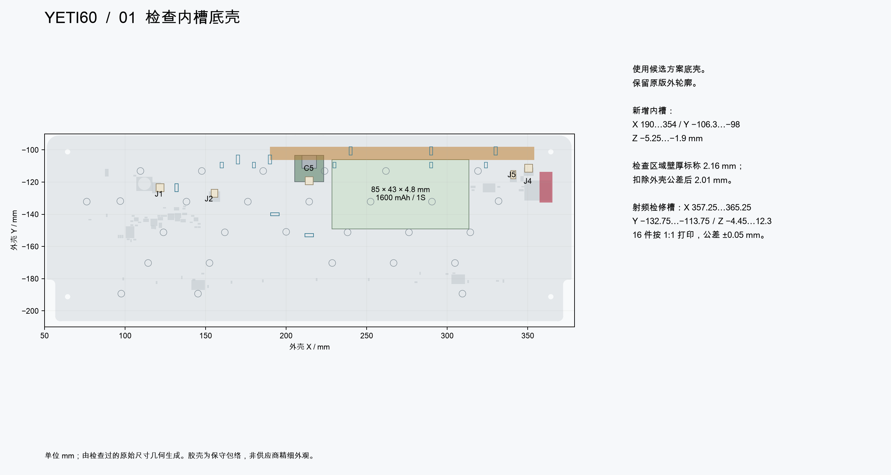
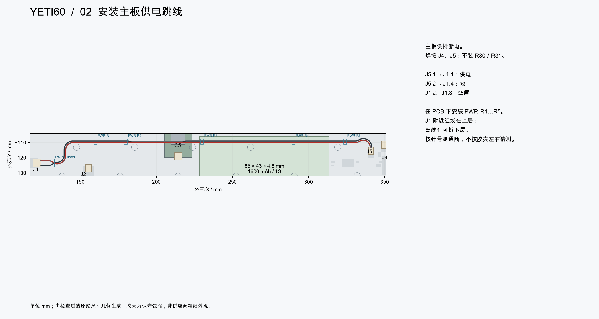
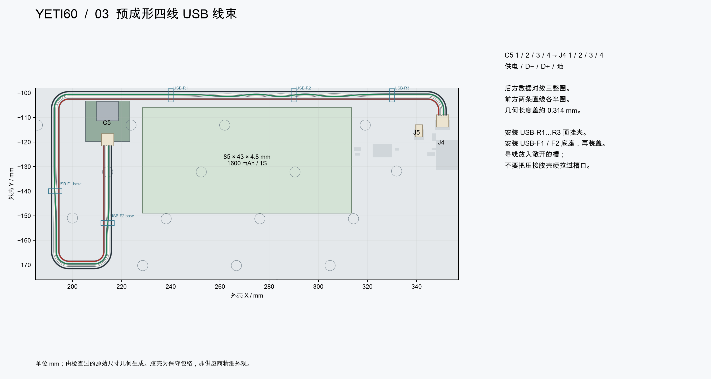
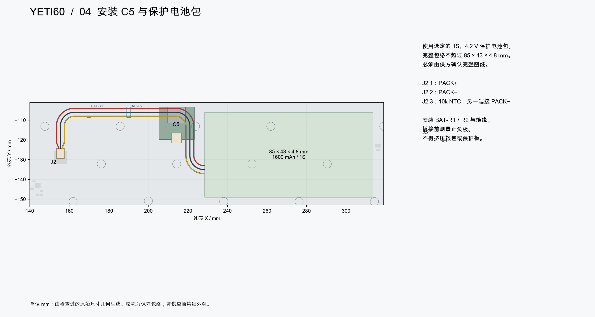
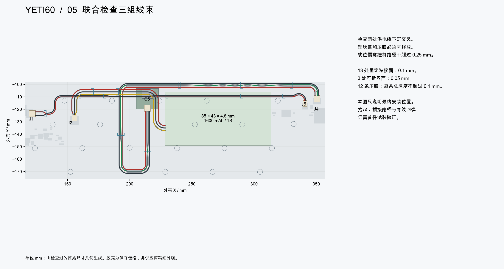
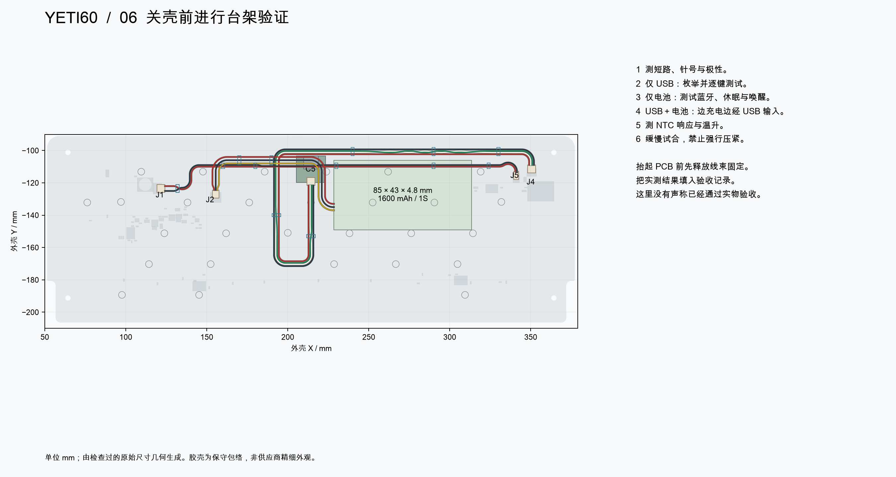
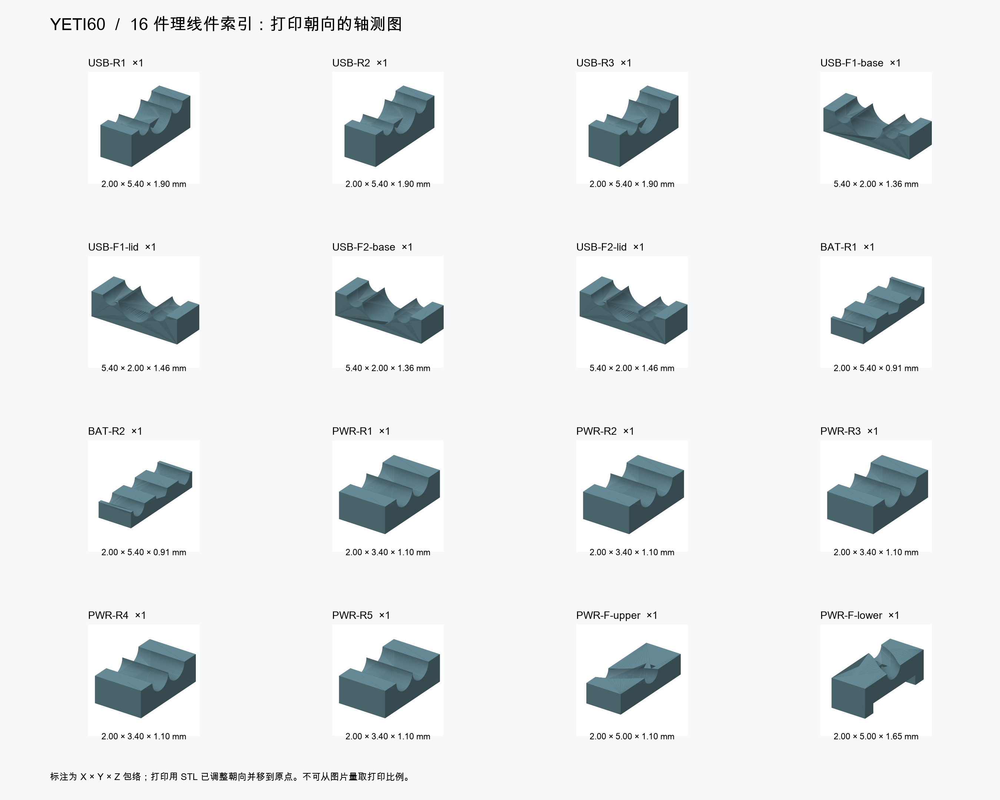
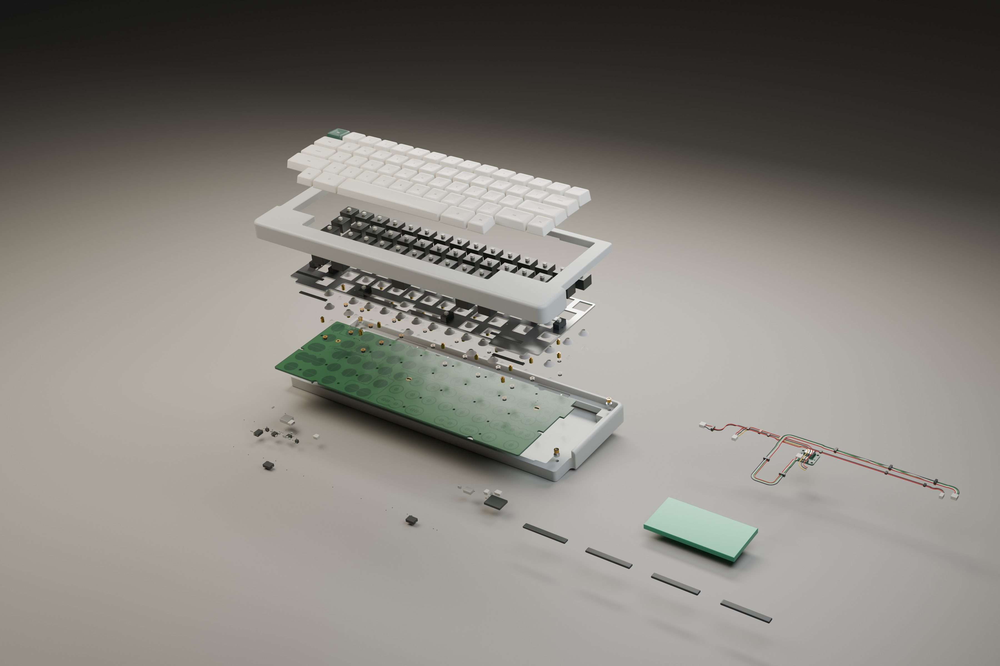

[English](ASSEMBLY.md) | 简体中文

# Raytac 修补候选方案：关壳装配

当前 U5 焊盘／钢网及 U5／U6 阻焊岛以[封装与普通工艺修订](PACKAGE-MODELS.zh-CN.md)为准；正反面均遮孔，旧的背面开放孔说明已作废。

当前机械件采用 [C04 定位板、开关底部避空和八条垫片](MECHANICAL-FIT.zh-CN.md)，替代原定位板外周和垫片原料托盘示意。

**装配路径进展：** [内部翼板避空与后部夹件已修订，断开线束后的连续标称刚体取出检查通过](SERVICE-PATH.zh-CN.md)。插头退出／插入、导线变形、散插头停放及组合公差尚未验收，不能据此批准整机拆装。

配合[候选主板、采购表和固件](README.zh-CN.md)使用。本指南替代原来的七线关壳插图；旧主板压缩包、旧五件理线件和旧线长不能与此方案混用。电气装配从候选方案的[焊接与开放台架顺序](README.zh-CN.md#焊接与开放台架顺序)开始。

最终安装几何已检查，包含五个接插胶壳。抬起／插接的检修路径、导线回弹、粘接保持力及实际供应商零件仍需首件验证。这是装配设计与试装流程，不是已完成的实物验收记录。

按[修订阻容规格及七处 0805 电源电容位置](PASSIVES.zh-CN.md)采购和焊接；旧 0603 电源电容位置图不适用于这七处。

## 准备变更的材料

| 材料 | 规格 | 每把数量 |
|---|---|---:|
| 主板 | 候选方案四层普通 FR4，标称 1.6 mm；使用其原生 PCB 与 75 件采购表 | 1 块 |
| F1 主板保险丝 | [Littelfuse 0466001.NRHF](F1-SELECTION.zh-CN.md)，1 A、63 V 一次性快断，使用修订焊盘，库存不抵扣 | 1 |
| J4／J5 | JST SM04B-SRSS-TB(LF)(SN)／SM02B-SRSS-TB(LF)(SN)，装在背面 | 各 1 |
| SH 线端胶壳 | C5、J4、J1 使用 SHR-04V-S；J5 使用 SHR-02V-S | 3＋1 |
| SH 端子 | SSH-003T-P0.2-H；J1 的 2／3 号位留空 | 实装 12；建议买 20 备损耗 |
| 电池胶壳／端子 | SHR-03V-S／SSH-003T-P0.2-H，优先由合格电池供方完成压接 | 1／3 |
| 内部导线 | AWG28 多股铜线；若三组统一用线，绝缘外径 0.5～0.8 mm，兼容指定 SH 端子；九条受控导线 | 9 根 |
| 底壳 | [候选内槽底壳 STEP](mechanical/yeti60-bottom-short-usb.step)／[打印 STL](mechanical/yeti60-bottom-short-usb.stl)，原版外形、1:1 | 1 件 |
| 理线件 | [16 个独立 STL／STEP 文件](CLOSED-CASE.zh-CN.md#打印零件)；后固化韧性树脂，尺寸须验到 ±0.05 mm | 16 件 |
| 固定粘接胶带 | 电绝缘；装配厚度 0.1 mm，不额外叠层 | 13 个粘接面 |
| 可拆粘接胶带 | 电绝缘；装配厚度 0.05 mm | 3 个界面 |
| 压线膜 | 电绝缘、可拆；每条含胶总厚度不超过 0.1 mm | 12 条 |
| 保护电池包 | 选定的 1S、4.2 V 方案，最低 1600 mAh；含膨胀余量的完整包络不超过 85 × 43 × 4.8 mm；独立温度断充及第三线 NTC | 1 包，须供方确认 |

未变更的 NiZ／钢板卫星轴、定位板、支柱、胶棉、紧固件、C5 和烧录用品见[制作总手册](../../BUILD.zh-CN.md)。保留 28 组安装件，H26 留空。此候选方案更改 USB／供电线束及底壳内槽，沿用此前检查过的定位板／PCB 叠层。若电池供方已经提供指定完整线束，不要重复购买第二套电池线。

## 01——检查底壳与打印件

使用候选底壳，不能使用未改动的原版底壳。检查后侧内槽及所有原有嵌件孔。新增内槽相邻检查区域的壁厚标称为 2.16 mm，扣除现有外壳公差后为 2.01 mm；不是说原版每一处壁都达到此值。每个理线件各打印一次。STL 已按毫米单位调整朝向并移到打印原点；STEP 保留装配坐标。去除槽内毛刺，不得随意扩大槽口。

## 02——焊接并验证供电跳线

未变更的元件仍按既定分阶段焊接流程进行，**不装 R30／R31**，J4／J5 按候选板原生坐标安装。电阻及通断检查时断开 USB 与电池。安装 PCB 侧供电理线件及跳线：**J5.1 → J1.1／J5.2 → J1.4**，确认 J1.2／3 留空。J1 扇出处红线走上层，黑线走可拆下层；先放红线，再装下层理线件。

## 03——预成形 USB 线束

使用[公开的九根导线 STEP](mechanical/harness/)及[自由长度表](CLOSED-CASE.zh-CN.md#完整接线)。长度从出线口量到出线口；压接下料长度由线束供方计算。USB 数据对后侧绞三整圈，前侧两条直线各半圈，使 C5 端针序恢复。C5 输出 1／2／3／4 接 J4.1／2／3／4。顶挂夹和前侧分体理线件可以打开后放入完整导线，不要把胶壳硬拉过槽。

## 04——安装 C5、绝缘与保护电池包

插入真实电池之前先完成 C5／主板单独供电测试。取得[供方参数确认](../../docs/build/battery-vendor-checklist.zh-CN.md)，包括完整电池包图纸、持续充电额定值、恒压范围和独立温度断充。用万用表确认 J2.1＝PACK+、J2.2＝PACK−、J2.3＝接向 PACK− 的 NTC。安装 BAT-R1／R2 与绝缘；使软包、保护板、焊点和螺钉头保持分离。不得将更厚的电池强塞进设计包络。

## 05——联合试装三组线束

使用指定粘接／压膜厚度，盖子保持可拆。检查两处供电线下沉交叉、J1 双层扇出及后侧 USB 内槽。最终线位偏离控制路径必须不超过 0.25 mm；这是装配测量要求，不能据此假设任意打印、胶带和成形误差叠加后仍然安全。检查完整路径后再固定压膜。

在线束和插座仍可接近时布置线束，逐渐试着降低叠层。如果插头够不到、导线弹出槽或需要用力才能坐实，立即停止。**静态净空通过，不能证明这个插入顺序一定可执行。** 首件需记录实际插接／抬起运动；检修抬起 PCB 前先释放全部线束固定。目前还没有合格的检修扫掠路径或实测连接器／粘接保持力。

## 06——开放台架验证，再试合壳

完成 [B0～B7 电气流程](../../OPEN-BENCH.zh-CN.md)，以候选方案 J4／J5 接线覆盖原 J1 数据连接。必须检查：仅 USB、仅电池／蓝牙、边充电边经 USB 输入、拔插切换、休眠唤醒、60 键校准与温升。首次功能测试不需要外壳，但仍需要真实 NiZ／定位板／胶碗／弹簧叠层及指定保护电池包。轻缓试合后重复电气和机械检查；不能凭充电指示灯判断 USB 数据正确或电芯温度安全。

## 零件索引与完整视图

[装配完整的键盘](assembly/assembled.png) · [后视图](assembly/rear.png) · [线束与电池安装位置](assembly/battery-space.png)

内部视图为了看清线路隐藏了 PCB／定位板，PCB 侧理线件仍保持真实安装坐标。

外壳、定位板、PCB 基体、导线路径、理线件和 C5 来自检查过的原尺寸几何。J1／J2／J4／J5 使用对齐后的原生 SH STEP 模型；J2 为低矮 SH 三针替换型号。接插胶壳、NiZ 轴座／滑块、胶碗／弹簧、键帽、材质、元件外形和紧固件细节中，尚无合格供方几何的部分仍为示意。爆炸图的分层间距只为看清零件，不是装配行程。PCB 表面视觉贴图使用原生铜层／焊盘几何，不是制板层，也不代表已经批准某一种表面处理。

[关壳尺寸](CLOSED-CASE.zh-CN.md) · [联合几何证据](audit/assembly.json) · [插图来源](audit/assembly-drawings.json) · [渲染来源](assembly/render-manifest.json) · [交付物一致性检查](audit/assembly-package.json) · [候选方案入口](README.zh-CN.md)

[供电压降及保险丝／线材验收](POWER-FEED.zh-CN.md)。
