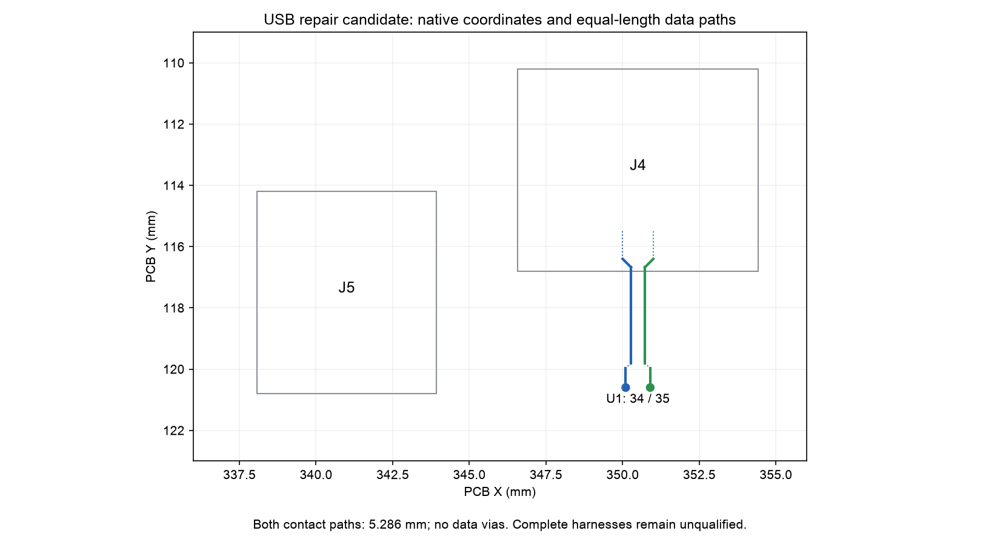

English | [Chinese](README.zh-CN.md)

# Raytac USB repair — prototype candidate

**Engineering candidate, not an ordering package.** This is a repair of the Raytac mainboard, not a third controller option. The canonical [build entry](../../BUILD.md), fabrication ZIP, placement illustrations and assembled renders still describe the previous routing. Do not combine their USB harness with this board. No Gerber release is provided here while the replacement harnesses and assembly illustrations remain incomplete.

The previous USB path crossed almost the full mainboard. This candidate moves the input next to the MDBT50Q-1MV2. J4 connects to C5 JSH; J5 supplies the retained left-side power/charger input through a separate two-wire jumper. All scanning, charger and regulator pin assignments remain unchanged. R30/R31 are removed: the nRF52840 USB PHY includes its termination, as confirmed by [Nordic](https://devzone.nordicsemi.com/f/nordic-q-a/82014/nrf52840-usb-d-d--impedance-matching/340456).

The COL14 inner-layer escape and SWD clock route are also moved away from the USB reference area. Front sensing copper, holes and pin assignments remain unchanged; parasitic capacitance/noise from the changed inner escape still requires real-key calibration.

## Files and current evidence

- [Native PCB](EC60-nRF52840.kicad_pcb), [project](EC60-nRF52840.kicad_pro), [schematic](EC60-nRF52840.kicad_sch), [fresh netlist](netlist.xml); frozen footprint/symbol libraries are included.
- [Complete mainboard purchase table](mainboard-purchase.csv): 75 fitted parts, 8 planned inventory parts, 67 net purchases. JP1 remains unpopulated. This table replaces the mainboard purchase table for this candidate only; other mechanical, battery, C5 and programming supplies remain in the [build entry](../../BUILD.md).
- [Strict native acceptance](audit/native-check.json), [DRC](audit/DRC-strict.json), [ERC](audit/ERC.json), [local mechanical/reference study](audit/geometry-check.json), [data-path extraction](audit/USB-paths.json).
- [Candidate firmware and provenance](firmware/README.md). These builds belong to this candidate PCB; physical execution remains unverified.



The contact-aware geometric paths are 5.286396 mm per leg, with zero data vias and zero geometric path mismatch. This includes pad-access bridges; it is not a propagation-delay or impedance result. The extracted trace portions are shorter because traversal within pads is reported separately. Reference coverage measures projected centerline over adjacent ground, not a solved return-current field or a passing USB eye.

## Required connection map

Read connector **pad numbers**, not wire colors or the apparent left/right order of a loose housing.

| Cable | Source | Destination | Signal |
|---|---|---|---|
| USB | C5 JSH output 1 | J4.1 | Protected USB supply, USB_FEED |
| USB | C5 JSH output 2 | J4.2 | USB D− |
| USB | C5 JSH output 3 | J4.3 | USB D+ |
| USB | C5 JSH output 4 | J4.4 | Ground |
| Power jumper | J5.1 | J1.1 | USB_FEED to retained VBUS input |
| Power jumper | J5.2 | J1.4 | Ground |

**J1.2 and J1.3 are deliberately unconnected.** The power jumper is mandatory: without it USB_FEED does not reach the original charger/input fuse or the MCU's retained USB_5V sensing branch. C5 remains mandatory for USB-C CC resistors, protection and its input fuse. Neither PD nor QC negotiation is added; this is the existing 5 V USB full-speed design.

USB charging and wired input are still concurrent: C5 → J4 → J5 → power jumper → J1/F1 → BQ24074 power path, while C5 data → J4 → nRF USB. Firmware selects USB HID when configured and applies the existing USB current policy; battery-only operation uses BLE. These are design/build checks, not observed hardware behavior.

## Additional and changed materials

Specifications come from the [JST SH drawing](https://www.jst-mfg.com/product/pdf/eng/eSH.pdf). Buy the side-entry surface-mount versions, not vertical or through-hole substitutions.

| Item | Exact specification | Installed quantity |
|---|---|---:|
| J4 header | JST SM04B-SRSS-TB(LF)(SN), SH 1.0 mm, 4 positions | 1 |
| J5 header | JST SM02B-SRSS-TB(LF)(SN), SH 1.0 mm, 2 positions | 1 |
| 4-position wire housing | JST SHR-04V-S: C5 end, J4 end, J1 power end | 3 |
| 2-position wire housing | JST SHR-02V-S: J5 end | 1 |
| SH crimp contacts | JST SSH-003T-P0.2-H, AWG28 compatible | 12; purchasing 20 allows 8 spares |
| USB link | 4 AWG28 stranded copper conductors, insulation OD 0.4–0.8 mm, 250 mm free length per conductor for the open bench | 1 cable |
| Power jumper | 2 AWG28 stranded copper conductors, insulation OD 0.4–0.8 mm, 300 mm free length per conductor for the open bench | 1 cable |
| R30/R31 | Removed; do not install the two inventory zero-ohm links | 0 |

Twist the USB D−/D+ pair; keep untwisted ends short and the two finished conductors matched within 1 mm. A qualified harness supplier must establish full-link impedance; a generic precrimped SH lead is not certified by its connector type. The 250/300 mm lengths above are **loose open-bench fixture lengths**, not validated enclosure routes or crimp cut lengths. JST's 1 A contact rating is specified with AWG28; that rating alone does not establish voltage drop, cable signal quality or temperature performance in this assembly.

The retained J1 is still a 4-position header. Populate only housing positions 1 and 4 for the power jumper; positions 2/3 stay empty. The jumper has a 2-position housing at J5 and a 4-position housing at J1. There are six USB/power conductors plus three battery leads, nine conductors total. Existing seven-wire combs and previous complete keyboard renders do not describe this candidate.

The battery is still required. Send the supplier the separate [battery parameter checklist](../../docs/build/battery-vendor-checklist.md); cell acceptance, complete pack thickness, independent temperature interruption and pin order require their confirmation. Do not buy an unprotected bare cell in place of that pack.

## Solder and open-bench sequence

1. Use this candidate's schematic, purchase table and native coordinates. The existing [illustrated soldering guide](../../docs/assembly/build-guide.md) remains useful for unchanged components, but skip R30/R31 and replace its USB wiring with the table above. Do not use old component-position images to locate J4/J5.
2. Inspect the bare PCB; keep front sensing copper clean. Keep JP1 open. Fit unchanged passives and power circuitry in the established staged sequence, checking rail-to-ground resistance before power. Continue to use the existing [B0–B7 open-bench procedure](../../OPEN-BENCH.md) for limits and power tests, with this document's USB wiring overriding its previous J1 data connection.
3. Fit J4 at PCB coordinate (350.5, 113.5) mm, J5 at (341.0, 117.5) mm, both on B.Cu at 0°. Locate pad 1 from the native pad identifier/mark. Tack one retention foot, align all signal pins, solder contacts, then the remaining retention foot. Inspect for bridges and lifted contacts.
4. With everything unpowered, continuity-test each cable end-to-end using the connection table; verify no adjacent shorts. Verify the assembled board's J4.2 → U1.34 and J4.3 → U1.35, and that J1.2/3 do not carry data. Check J5.1 → J4.1, then fit the J5-to-J1 power jumper.
5. Mount the PCB and C5 on insulated supports. Leave the two fixture cables loose and clear of sensing springs and solder points. Use the selected NiZ/plate/stabilizer assembly from the build entry; an enclosure is unnecessary, but the switch/plate/dome/spring stack is necessary for meaningful key testing.
6. With the battery disconnected, apply current-limited power following B0–B3; verify retained input, system and 3.3 V rails. Flash the candidate calibrator through J3/SWD using its [firmware instructions](firmware/README.md), then test USB enumeration. If USB-only power fails, check the mandatory J5 → J1 jumper before debugging firmware.
7. Once the supplier's battery limits and polarity are confirmed, remove USB power, connect the protected pack at J2, and follow B4–B5. Reconnect USB and measure input voltage at J1/U5 under charging load, current and temperature. Verify the calibration console stays on USB while the battery charges; do not infer this from a charging LED alone.
8. Complete B6 calibration with real keys, flash the candidate normal build, test wired HID while charging, then unplug USB and test BLE and reconnect behavior under B7. Record results. These are physical acceptance steps and have not been performed here.

## Remaining release work

The native electrical repair is reviewable. The two complete cable routes, connector strain relief/service access, revised route guides and complete assembly illustrations still need integration. Local header/plug clearance is a narrower check. Do not substitute the old fabrication ZIP, old wire lengths or old full assembly render as evidence for this candidate. The canonical manufacturing hold remains in force.

Reproduce the current checks from the repository root:

```sh
/Applications/KiCad/KiCad.app/Contents/Frameworks/Python.framework/Versions/3.9/bin/python3 variants/raytac/scripts/check_usb_short_route.py
/Applications/KiCad/KiCad.app/Contents/Frameworks/Python.framework/Versions/3.9/bin/python3 variants/raytac/tests/audit/test_usb_short_route.py
/path/to/project-cad-python variants/raytac/scripts/study_usb_short_route.py
```

The CAD runtime is the same one used by the canonical audit; its dependencies are pinned in the Raytac requirements files. Reports explicitly retain the physical and supplier limitations.
