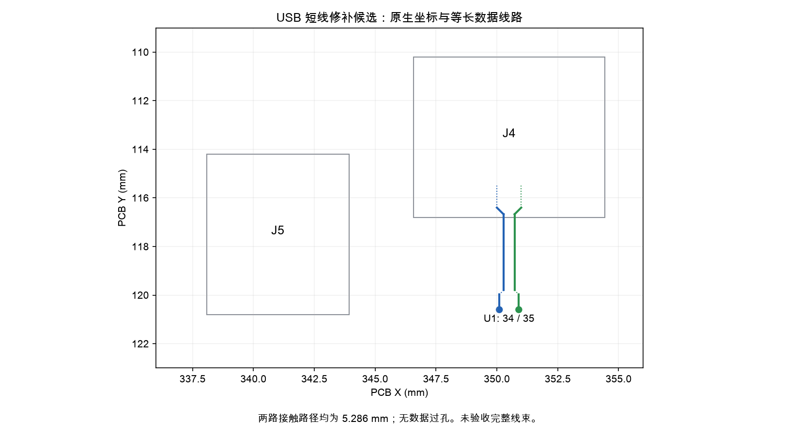

[English](README.md) | 简体中文

# Raytac USB 修补候选板

**这是工程候选板，尚未发布下单包。** 它是 Raytac 主板的修补版本，不是第三种主控方案。[制作总入口](../../BUILD.zh-CN.md)、原制板压缩包、元件位置图和整机渲染仍对应原布线。不能把原 USB 线束与本板混用。关壳线束、16 件理线件及装配插图已经补齐；检修插接路径、供方材料确认和首件验收仍未完成，因此这里尚不提供发布版 Gerber。

原 USB 数据线路横跨整块主板。本候选板将输入移到 MDBT50Q-1MV2 附近：J4 接 C5 JSH 子板，J5 经独立两线跳线接回左侧原电源／充电入口。扫描、充电器及稳压器的引脚分配保持不变。移除 R30／R31 两颗零欧姆电阻；[Nordic 原厂说明](https://devzone.nordicsemi.com/f/nordic-q-a/82014/nrf52840-usb-d-d--impedance-matching/340456)确认 nRF52840 的 USB PHY 已内置端接。

同时调整了 COL14 的内层引出线和 SWD 时钟线，以避开 USB 对线下方的地参考区域。正面感应铜、孔位和引脚分配保持不变；内层引出变化带来的寄生电容及噪声仍需真实按键校准验证。

[关壳线束与 16 件理线件](CLOSED-CASE.zh-CN.md)提供路径、内槽底壳、STEP／STL 与材料数量。[分步装配指南及完整爆炸图](ASSEMBLY.zh-CN.md)与九线方案对应；不要与其他旧装配插图混用。

[供电压降核算与保险丝／线材验收要求](POWER-FEED.zh-CN.md)已补充：满充电流不能只凭导线规格和保险丝标称电流保证。

## 文件与现有证据

- [原生 PCB](EC60-nRF52840.kicad_pcb)、[工程](EC60-nRF52840.kicad_pro)、[原理图](EC60-nRF52840.kicad_sch)、[重新导出的网表](netlist.xml)；所需冻结封装及符号库均在本目录中。
- [完整主板补购表](mainboard-purchase.zh-CN.csv)：装配 75 个元件，计划使用库存 8 个、净补购 67 个。JP1 默认不装。此表只替换本候选板的主板补购清单，机械件、电池、C5 子板及烧录工具仍见[制作总入口](../../BUILD.zh-CN.md)。
- [严格原生检查](audit/native-check.json)、[DRC](audit/DRC-strict.json)、[ERC](audit/ERC.json)、[局部机械／地参考检查](audit/geometry-check.json)、[数据路径提取](audit/USB-paths.json)。
- [本候选板固件与来源](firmware/README.zh-CN.md)。固件已针对本候选板重新构建，尚未在实物上运行。



两路几何接触路径均为 5.286396 mm，无数据过孔，几何路径差为零。该长度包含焊盘接入段，不是传播延迟或阻抗结果。实际提取出的走线部分较短，因为焊盘内部接入段单独计算。地参考覆盖率只检查中心线向相邻层地铜的投影，不代表已求解回流电场或通过 USB 眼图。

## 必须采用的连接方式

按连接器的**焊盘编号**接线，不能只看线色或散装胶壳表面上的左右顺序。

| 线束 | 起点 | 终点 | 信号 |
|---|---|---|---|
| USB | C5 JSH 输出 1 | J4.1 | 经过保护的 USB 供电，USB_FEED |
| USB | C5 JSH 输出 2 | J4.2 | USB D− |
| USB | C5 JSH 输出 3 | J4.3 | USB D+ |
| USB | C5 JSH 输出 4 | J4.4 | 地 |
| 电源跳线 | J5.1 | J1.1 | 将 USB_FEED 接回原 VBUS 入口 |
| 电源跳线 | J5.2 | J1.4 | 地 |

**J1.2、J1.3 明确不连接。** 电源跳线必须安装，否则 USB_FEED 不会进入原充电器／输入保险丝，也不能到达主控保留的 USB_5V 检测支路。C5 子板仍然必须安装，继续提供 USB-C 的 CC 电阻、保护及输入保险丝。没有新增 PD 或 QC 协议，仍采用原有的 5 V USB 全速方案。

边充电边走 USB 的路径为：C5 → J4 → J5 → 电源跳线 → J1／F1 → BQ24074 电源路径，同时数据由 C5 → J4 → nRF USB。固件在 USB 完成配置后优先使用 USB HID，并执行原有 USB 电流策略；仅电池供电时使用 BLE。这是设计及构建验证结果，尚未通过实物操作证明。

## 增加及变化的材料

规格依据 [JST SH 原厂图纸](https://www.jst-mfg.com/product/pdf/eng/eSH.pdf)。要买侧插卧贴型，不能用立式或通孔版本直接替换。

| 材料 | 具体规格 | 安装数量 |
|---|---|---:|
| J4 插座 | JST SM04B-SRSS-TB(LF)(SN)，SH 1.0 mm，4 针 | 1 |
| J5 插座 | JST SM02B-SRSS-TB(LF)(SN)，SH 1.0 mm，2 针 | 1 |
| 四位胶壳 | JST SHR-04V-S，分别用于 C5 端、J4 端、J1 电源端 | 3 |
| 两位胶壳 | JST SHR-02V-S，用于 J5 端 | 1 |
| SH 压接端子 | JST SSH-003T-P0.2-H，适配 AWG28 | 安装 12 个；购买 20 个可留 8 个备件 |
| USB 连接线 | 4 根 AWG28 多股铜线，绝缘外径 0.4–0.8 mm，裸板测试时每根自由长度 250 mm | 1 条线束 |
| 电源跳线 | 2 根 AWG28 多股铜线，绝缘外径 0.4–0.8 mm，裸板测试时每根自由长度 300 mm | 1 条线束 |
| R30／R31 | 已移除，不再使用库存中的这两颗零欧姆电阻 | 0 |

USB D−／D+ 应采用双绞线，尽量缩短两端解绞长度，两根成品导线长度差控制在 1 mm 内。完整线束的阻抗仍需合格供方确认，普通预压端 SH 线不能仅凭接头型号就视为 USB 信号已合格。上述 250／300 mm 是**裸板测试时松放在外部的线长**，不是已通过关壳检查的线束路径，也不是压接下料长度。JST 的 1 A 额定电流以 AWG28 为条件，不能单独证明本装配中的压降、信号或温升符合要求。

J1 仍为四针插座。电源跳线在 J1 胶壳中只装第 1、4 位，第 2、3 位留空；J5 一端则用两位胶壳。两条新线束共六根导线，加上电池三根线，总计九根。原有七根线的理线梳及整机渲染不适用于本候选板。

仍然需要电池。请把单独的[电池供应商参数核对表](../../docs/build/battery-vendor-checklist.zh-CN.md)发给供方，确认电芯条件、完整包厚度、独立温度断充和线序。不能用无保护裸电芯替代该电池包。

## 焊接及裸板测试顺序

1. 使用本候选板的原理图、补购表和原生坐标。原[逐步焊接图解](../../docs/assembly/build-guide.zh-CN.md)可用于没有变化的元件，但要跳过 R30／R31，USB 接线完全以本页为准。不能凭原元件位置图寻找 J4／J5。
2. 检查裸 PCB，保持正面感应铜清洁，JP1 留空。按原来的分阶段顺序装无变化的阻容及电源电路，上电前检查电源对地电阻。仍使用 [B0—B7 裸板验收流程](../../OPEN-BENCH.zh-CN.md)中的限值和上电测试，但其中原 J1 数据线接法由本页覆盖。
3. J4 安装在 PCB 坐标 (350.5, 113.5) mm，J5 安装在 (341.0, 117.5) mm，均在背面 B.Cu、方向为 0°。按原生焊盘标记确认第 1 脚。先定位焊一侧固定脚，校准信号脚，再焊触点和另一侧固定脚，检查连锡与虚焊。
4. 全部断电，按接线表逐根量通断并排除相邻短路。检查装好主板的 J4.2 → U1.34、J4.3 → U1.35；J1.2／3 不应承载数据。检查 J5.1 → J4.1，再安装 J5 到 J1 的电源跳线。
5. 将主板和 C5 放在绝缘支撑上，两条测试线松放并避开感应弹簧及焊点。使用制作总入口中选定的 NiZ／定位板／钢板卫星轴结构。不需要外壳，但要验证按键，仍需要轴座、滑块、定位板、胶碗和弹簧形成正确结构。
6. 不接电池，按 B0—B3 限流上电，检查原输入、系统电源及 3.3 V。按[候选固件说明](firmware/README.zh-CN.md)通过 J3／SWD 刷入校准版，检查 USB 枚举。仅 USB 供电不工作时，先排查必须安装的 J5 → J1 跳线。
7. 供方确认电池参数和极性后，拔掉 USB，将保护电池包接入 J2，按 B4—B5 测试。再次接上 USB，在充电负载下测量 J1／U5 的输入电压、充电电流和温度。确认校准控制台在电池充电时仍保持 USB 连接，不能只凭充电指示灯作判断。
8. 使用真实按键完成 B6 校准，刷入本候选板的正常版固件，检查边充电边通过 USB 输入；拔掉 USB，按 B7 检查 BLE 及重新插入 USB 的行为并记录结果。这些实物验收尚未执行。

## 尚未完成的发布工作

原生电气修补、九线关壳路径、五个接插胶壳、16 件理线件及完整装配插图已联合检查。仍需解决检修插接／抬起路径、真实导线回弹与保持力、最终元件／电池供方资格及实物验收。详见[分步装配指南](ASSEMBLY.zh-CN.md)。原制板包的暂停状态保持；旧线长和旧整机图不是本候选方案的证据。

在仓库根目录复现当前检查：

```sh
/Applications/KiCad/KiCad.app/Contents/Frameworks/Python.framework/Versions/3.9/bin/python3 variants/raytac/scripts/check_usb_short_route.py
/Applications/KiCad/KiCad.app/Contents/Frameworks/Python.framework/Versions/3.9/bin/python3 variants/raytac/tests/audit/test_usb_short_route.py
/path/to/project-cad-python variants/raytac/scripts/study_usb_short_route.py
```

第三条命令使用正式审查所用的 CAD Python 环境，依赖版本见 Raytac 的依赖文件。所有报告均保留实物测试及供方证据的边界。
